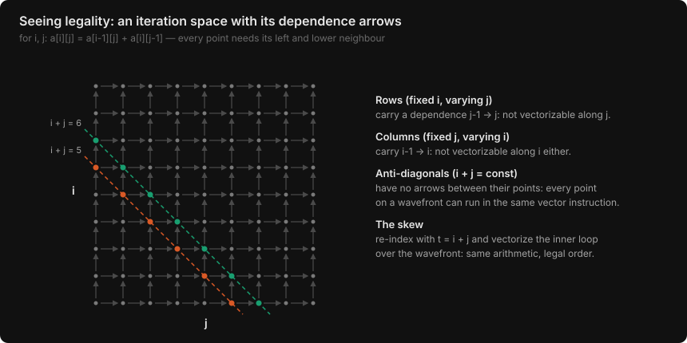
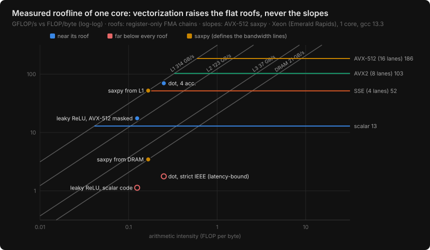
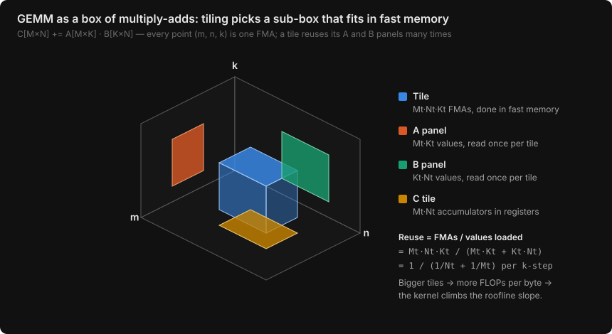

[← Back to Table of Contents](./README.md)

# Chapter 4 — Seeing Vectors: A Visual Grammar

> *"Every vectorization bug I have fixed was visible in a drawing I had not made yet."*

## Overview

Vectorization is a spatial idea: lanes side by side, iterations on a grid, bytes in cache lines,
instructions overlapping in time. Text and source code flatten all of it into one dimension, which
is why it is hard to reason about from code alone. This chapter defines **seven drawings**, the visual
grammar used throughout the book. For each it gives the question it answers, how to draw it by hand,
and which tool draws it for you. The rule of thumb: make the drawing *before* the kernel. It is
cheaper to be wrong on paper.

<div class="legend-grid">
<div class="legend-item"><b>1 · Register strip</b>What is in each lane, before and after one instruction?<div class="mini reg-lanes" style="display:inline-flex"><span class="ln">a0</span><span class="ln l1">a1</span><span class="ln l2">a2</span><span class="ln off">a3</span></div><br>Use for: shuffles, masks, reductions, widening.</div>
<div class="legend-item"><b>2 · Iteration space</b>Which iterations depend on which? Dots for iterations, arrows for dependences.<br>Use for: legality, loop interchange, skewing, tiling.</div>
<div class="legend-item"><b>3 · Memory strip</b>Which bytes does each access touch, grouped into cache lines?<div class="mini" style="display:inline-flex"><span class="cl"><i class="use"></i><i class="load"></i><i class="load"></i><i class="load"></i></span><span class="cl"><i class="use"></i><i class="load"></i><i class="load"></i><i class="load"></i></span></div><br>Use for: stride, layout, coalescing.</div>
<div class="legend-item"><b>4 · Piano roll</b>Which instruction occupies which execution unit in which cycle?<br>Use for: latency vs throughput, accumulators, pipelining.</div>
<div class="legend-item"><b>5 · Roofline</b>Is this kernel limited by arithmetic or by bytes, and how far below the limit is it?<br>Use for: profitability, before any optimisation.</div>
<div class="legend-item"><b>6 · Tile box</b>Which block of the iteration space is resident in which memory level?<br>Use for: GEMM, convolution, attention, any reuse.</div>
<div class="legend-item"><b>7 · Shape strip</b>Which tensor axis is the lane axis, which is the batch, which is reduced?<div class="mini tensor-shape" style="display:inline-flex"><span class="ts-bracket">[</span><span class="ts-dim batch">B</span><span class="ts-sep">,</span><span class="ts-dim seq">T</span><span class="ts-sep">,</span><span class="ts-dim feature">D</span><span class="ts-bracket">]</span></div><br>Use for: broadcasting, vmap, einsum, layouts.</div>
<div class="legend-item"><b>+ Mask grid</b>For every chunk of V lanes, which lanes take which side of a branch?<br>Use for: divergence, utilisation (Chapter 8).</div>
</div>

---

## Drawing 1 — The register strip

**Question:** what does one instruction do to each lane? **Draw:** one row per register, one box
per lane, lane 0 on the left (lowest address), same colour for values that came from the same source.
Draw it whenever an instruction is *not* lane-wise (shuffles, reductions, widening, compress), because
those are where off-by-one-lane bugs live.

<div class="regs">
<div class="regs-title">Interleave two registers (unpacklo) — the source of every "my RGB came out as RRGGBB" bug</div>
<div class="reg-row"><span class="reg-name">a</span><span class="reg-lanes"><span class="ln">a0</span><span class="ln">a1</span><span class="ln">a2</span><span class="ln">a3</span></span></div>
<div class="reg-row"><span class="reg-name">b</span><span class="reg-lanes"><span class="ln l4">b0</span><span class="ln l4">b1</span><span class="ln l4">b2</span><span class="ln l4">b3</span></span></div>
<div class="reg-row"><span class="reg-name">unpacklo(a, b)</span><span class="reg-lanes"><span class="ln">a0</span><span class="ln l4">b0</span><span class="ln">a1</span><span class="ln l4">b1</span></span><span class="reg-note">only the low halves</span></div>
<div class="reg-row"><span class="reg-name">unpackhi(a, b)</span><span class="reg-lanes"><span class="ln">a2</span><span class="ln l4">b2</span><span class="ln">a3</span><span class="ln l4">b3</span></span></div>
</div>

**Tools:** `gdb` prints vector registers (`p $zmm0.v16_float`); Compiler Explorer (godbolt.org) shows
the instructions next to the source line that made them; the Intel Intrinsics Guide has a
pseudocode "Operation" box for every intrinsic, which is a register strip written as a loop.

---

## Drawing 2 — The iteration space

**Question:** may these iterations run at the same time? **Draw:** one dot per iteration of the loop
nest (a line for one loop, a grid for two). Then draw an arrow from each iteration that *writes* a
value to each iteration that later *reads* it. Iterations with no arrow between them may share a
vector; arrows that point *within* a vector-sized chunk forbid it.

<div class="fig"></div>

The figure shows the classic surprise. A two-dimensional recurrence looks unvectorizable along both
loops, yet every *anti-diagonal* is free of internal arrows. Re-indexing the loop by $t = i + j$
(a **skew**) exposes a vectorizable inner loop. The drawing finds it in seconds; staring at
`a[i][j] = a[i-1][j] + a[i][j-1]` usually does not. [Chapter 6](./06_dependences.md) makes the arrows
precise as *dependence distance vectors*; its lab draws them for a one-dimensional loop as you move
the read and write offsets.

**Tools:** polyhedral compilers (Polly in LLVM, PPCG, isl) represent exactly this picture internally;
`clang -Rpass-analysis=loop-vectorize` reports the arrow that blocked vectorization in words.

---

## Drawing 3 — The memory strip

**Question:** how many bytes does the hardware move to give each lane its element? **Draw:** memory
as a row of elements, boxed into cache lines (64 bytes on x86 and most Arm cores; 128-byte lines and
32-byte sectors on NVIDIA GPUs). Colour the elements you use. Every touched box is paid for in full.

<div class="mem">
<div class="mem-row"><span class="mem-name">stride 1</span><span class="cl touched"><i class="use"></i><i class="use"></i><i class="use"></i><i class="use"></i><i class="use"></i><i class="use"></i><i class="use"></i><i class="use"></i><i class="use"></i><i class="use"></i><i class="use"></i><i class="use"></i><i class="use"></i><i class="use"></i><i class="use"></i><i class="use"></i></span><span class="mem-note">16 lanes · 1 line · 100 % useful</span></div>
<div class="mem-row"><span class="mem-name">stride 4</span><span class="cl touched"><i class="use"></i><i class="load"></i><i class="load"></i><i class="load"></i><i class="use"></i><i class="load"></i><i class="load"></i><i class="load"></i><i class="use"></i><i class="load"></i><i class="load"></i><i class="load"></i><i class="use"></i><i class="load"></i><i class="load"></i><i class="load"></i></span><span class="cl touched"><i class="use"></i><i class="load"></i><i class="load"></i><i class="load"></i><i class="use"></i><i class="load"></i><i class="load"></i><i class="load"></i><i class="use"></i><i class="load"></i><i class="load"></i><i class="load"></i><i class="use"></i><i class="load"></i><i class="load"></i><i class="load"></i></span><span class="mem-note">8 of 16 lanes shown · 25 % useful</span></div>
<div class="mem-row"><span class="mem-name">stride 16</span><span class="cl touched"><i class="use"></i><i class="load"></i><i class="load"></i><i class="load"></i><i class="load"></i><i class="load"></i><i class="load"></i><i class="load"></i><i class="load"></i><i class="load"></i><i class="load"></i><i class="load"></i><i class="load"></i><i class="load"></i><i class="load"></i><i class="load"></i></span><span class="cl touched"><i class="use"></i><i class="load"></i><i class="load"></i><i class="load"></i><i class="load"></i><i class="load"></i><i class="load"></i><i class="load"></i><i class="load"></i><i class="load"></i><i class="load"></i><i class="load"></i><i class="load"></i><i class="load"></i><i class="load"></i><i class="load"></i></span><span class="mem-note">2 of 16 lanes shown · 6.25 % useful</span></div>
</div>
<div class="genre-caption">fp32 elements, 64-byte cache lines. Cyan: the element a lane wanted. Grey: the bytes that came along anyway.</div>

**Tools:** in Python the strip is one attribute away. `x.strides` (NumPy, bytes) and `x.stride()`
(PyTorch, elements) tell you the step between neighbours along every axis; `x.is_contiguous()` and
`x.flags['C_CONTIGUOUS']` answer the yes/no version. On GPUs, Nsight Compute's *Memory Workload
Analysis* reports "sectors per request", which is this drawing as a number (4 is perfect for fp32).

```python
import torch
x = torch.randn(32, 128, 64)          # [B, T, D]
print(x.stride())                     # (8192, 64, 1)  -> D is contiguous: lanes along D are free
print(x.transpose(1, 2).stride())     # (8192, 1, 64)  -> along T now; lanes along D are stride 64
print(x[:, :, ::4].stride())          # (8192, 64, 4)  -> a view: every 4th element, 25 % useful bytes
```

---

## Drawing 4 — The piano roll

**Question:** is the loop limited by how *long* each instruction takes (latency) or by how *many* can
start per cycle (throughput)? **Draw:** time in cycles left to right, one row per execution unit or
per dependency chain, one bar per instruction spanning its latency.

<div class="roll" style="--cols:16">
<div class="roll-title">Dot product, one accumulator: every FMA waits for the previous one (latency 4)</div>
<div class="roll-row"><span class="roll-name">acc0 chain</span><span class="roll-track"><span class="note n0" style="grid-column:1 / span 4">fma 0</span><span class="note n0" style="grid-column:5 / span 4">fma 1</span><span class="note n0" style="grid-column:9 / span 4">fma 2</span><span class="note n0" style="grid-column:13 / span 4">fma 3</span></span></div>
<div class="roll-row"><span class="roll-name">FMA port 0</span><span class="roll-track"><span class="note n2" style="grid-column:1 / span 1">·</span><span class="note stall" style="grid-column:2 / span 3">idle</span><span class="note n2" style="grid-column:5 / span 1">·</span><span class="note stall" style="grid-column:6 / span 3">idle</span><span class="note n2" style="grid-column:9 / span 1">·</span><span class="note stall" style="grid-column:10 / span 3">idle</span><span class="note n2" style="grid-column:13 / span 1">·</span><span class="note stall" style="grid-column:14 / span 3">idle</span></span></div>
<div class="roll-row"><span class="roll-name">FMA port 1</span><span class="roll-track"><span class="note stall" style="grid-column:1 / span 16">idle the whole time</span></span></div>
<div class="roll-axis"><span></span><span class="ticks"><span>0</span><span></span><span></span><span></span><span>4</span><span></span><span></span><span></span><span>8</span><span></span><span></span><span></span><span>12</span><span></span><span></span><span>15</span></span></div>
</div>
<div class="roll" style="--cols:16">
<div class="roll-title">Four accumulators: four independent chains overlap</div>
<div class="roll-row"><span class="roll-name">acc0</span><span class="roll-track"><span class="note n0" style="grid-column:1 / span 4">fma</span><span class="note n0" style="grid-column:5 / span 4">fma</span><span class="note n0" style="grid-column:9 / span 4">fma</span><span class="note n0" style="grid-column:13 / span 4">fma</span></span></div>
<div class="roll-row"><span class="roll-name">acc1</span><span class="roll-track"><span class="note n1" style="grid-column:1 / span 4">fma</span><span class="note n1" style="grid-column:5 / span 4">fma</span><span class="note n1" style="grid-column:9 / span 4">fma</span><span class="note n1" style="grid-column:13 / span 4">fma</span></span></div>
<div class="roll-row"><span class="roll-name">acc2</span><span class="roll-track"><span class="note n2" style="grid-column:2 / span 4">fma</span><span class="note n2" style="grid-column:6 / span 4">fma</span><span class="note n2" style="grid-column:10 / span 4">fma</span><span class="note n2" style="grid-column:14 / span 3">fma…</span></span></div>
<div class="roll-row"><span class="roll-name">acc3</span><span class="roll-track"><span class="note n3" style="grid-column:2 / span 4">fma</span><span class="note n3" style="grid-column:6 / span 4">fma</span><span class="note n3" style="grid-column:10 / span 4">fma</span><span class="note n3" style="grid-column:14 / span 3">fma…</span></span></div>
<div class="roll-axis"><span></span><span class="ticks"><span>0</span><span></span><span></span><span></span><span>4</span><span></span><span></span><span></span><span>8</span><span></span><span></span><span></span><span>12</span><span></span><span></span><span>15</span></span></div>
<div class="roll-legend">To fill two FMA ports with a 4-cycle latency you need 4 × 2 = 8 chains in flight (Little's law). Four chains fill half; measured, four already saturate this core's two load ports, so eight are no faster (Chapter 14).</div>
</div>

**Tools:** `llvm-mca` simulates exactly this for a block of assembly. Here is its real output for the two
loop bodies above, on its Sapphire Rapids model (`tools/measurements/mca/`):

<div class="crt">
<div class="crt-bar">tty1 — llvm-mca -mcpu=sapphirerapids -timeline dot1.s / dot4.s</div>
<div class="crt-screen"><pre>
<span class="dim">### one accumulator (zmm0 in every FMA)</span>
[0,0]  DeeeeeeeeeeeeER.    .    .    .   vfmadd231ps (%rdi,%rax), %zmm1, %zmm0
[0,1]  D<span class="bad">======</span>eeeeeeeeeeeeER    .    .   vfmadd231ps 64(%rdi,%rax), %zmm2, %zmm0
[0,2]  D<span class="bad">============</span>eeeeeeeeeeeeER   .   vfmadd231ps 128(%rdi,%rax), %zmm3, %zmm0
[0,3]  .D<span class="bad">=================</span>eeeeeeeeeeeeER  vfmadd231ps 192(%rdi,%rax), %zmm4, %zmm0
Total Cycles: 2409   (100 iterations)   IPC: 0.17

<span class="dim">### four accumulators (zmm0, zmm5, zmm6, zmm7)</span>
[0,0]  DeeeeeeeeeeeeER.    .  .   vfmadd231ps (%rdi,%rax), %zmm1, %zmm0
[0,1]  D=eeeeeeeeeeeeER    .  .   vfmadd231ps 64(%rdi,%rax), %zmm2, %zmm5
[0,2]  D==eeeeeeeeeeeeER   .  .   vfmadd231ps 128(%rdi,%rax), %zmm3, %zmm6
[0,3]  .D==eeeeeeeeeeeeER  .  .   vfmadd231ps 192(%rdi,%rax), %zmm4, %zmm7
Total Cycles: 612    (100 iterations)   IPC: 0.65
</pre></div>
</div>

`D` is dispatch, `e` is executing (the load and FMA together), `=` is *waiting for an operand*. The
staircase of `=` in the first block is the latency chain drawn by a machine. The model predicts
2409 / 612 = 3.9× from accumulators alone; on the real core we measured 2.5× (28.1 → 69.8 GFLOP/s),
because loads cap the second case. **uiCA** (uops.info) and Intel VTune give similar views; on GPUs,
Nsight Compute's *warp state* statistics are the same picture aggregated over warps.

---

## Drawing 5 — The roofline

**Question:** what is the best this kernel can possibly do here, and which ceiling is it under?
**Draw:** log-log axes, arithmetic intensity (FLOP per byte) across, performance up. Draw a flat
line for each compute peak and a slanted line for each bandwidth. Put the kernel's dot at its
measured intensity and speed.

<div class="fig"></div>

This is the most important drawing in the book because it answers question 5, *is it worth it?*,
before you write anything. A dot on a slanted line will not move up with a wider register. A dot far
below every line has a problem the roofline cannot name (latency chains, the strict-IEEE dot product
above), and the piano roll is the next drawing to make. [Chapter 9](./09_profitability.md) builds it
from scratch and has a lab.

---

## Drawing 6 — The tile box

**Question:** which data is reused, and where does it live while it is reused? **Draw:** the loop
nest as a box, one axis per loop. Every point is one multiply-add. A *tile* is a sub-box; its shadows
on the walls are the slices of each operand it needs.

<div class="fig"></div>

The ratio of the tile's volume to its shadows is its arithmetic intensity, which is why tiling moves
a kernel up the roofline's slanted line. The same picture explains cache blocking on CPUs, shared-memory
tiling in CUDA, the tile shapes of tensor cores and AMX, and why FlashAttention never writes the
$T \times T$ attention matrix to memory ([Chapter 18](./18_ml_kernels.md)).

---

## Drawing 7 — The shape strip

**Question:** which axis is the lane axis, which is batched, which is reduced, and which is
broadcast? **Draw:** the tensor's shape as labelled boxes, coloured by role, and draw the operation as
an arrow between strips.

<div class="tensor-flow">
<div class="tensor-flow-row"><div class="tensor-shape"><span class="ts-bracket">[</span><span class="ts-dim batch">B</span><span class="ts-sep">,</span><span class="ts-dim heads">H</span><span class="ts-sep">,</span><span class="ts-dim seq">T</span><span class="ts-sep">,</span><span class="ts-dim feature">d</span><span class="ts-bracket">]</span></div><span class="tensor-label">Q</span><span class="tensor-arrow">·</span><div class="tensor-shape"><span class="ts-bracket">[</span><span class="ts-dim batch">B</span><span class="ts-sep">,</span><span class="ts-dim heads">H</span><span class="ts-sep">,</span><span class="ts-dim kv">S</span><span class="ts-sep">,</span><span class="ts-dim feature">d</span><span class="ts-bracket">]</span></div><span class="tensor-label">K</span><span class="tensor-arrow">→</span><div class="tensor-shape"><span class="ts-bracket">[</span><span class="ts-dim batch">B</span><span class="ts-sep">,</span><span class="ts-dim heads">H</span><span class="ts-sep">,</span><span class="ts-dim seq">T</span><span class="ts-sep">,</span><span class="ts-dim kv">S</span><span class="ts-bracket">]</span></div><span class="tensor-label">scores</span></div>
<div class="tensor-label">einsum("bhtd,bhsd->bhts"): B and H are batch axes (independent), T and S are kept, d is reduced. On a CPU the lanes run along d (contiguous); a tensor core instead treats each (b, h) slice as one small GEMM.</div>
</div>

`einsum` notation *is* a shape strip in text: every letter is an axis, letters on both sides survive,
letters only on the left are reduced. Shape annotations in code (`jaxtyping`'s
`Float[Array, "b h t d"]`, or comments like `# [B, T, D]`) keep the strip next to the code where it
cannot drift.

<div class="callout ponder"><span class="callout-title">Ponder</span>
<p>In the attention strip, the reduced axis <em>d</em> is short (64–128) and contiguous, while the kept axis
<em>S</em> can be 100 000 long. Which would you rather put on the lanes of a 16-wide register, and which on
the threads of a GPU? The answer changes between prefill and decode, which is one reason those two
phases get different kernels.</p>
</div>

---

## Choosing the drawing

| You are asking… | Draw | Then read |
|---|---|:---:|
| "Why won't the compiler vectorize this?" | iteration space | [6](./06_dependences.md), [13](./13_auto_vectorization.md) |
| "It vectorized; why is it not faster?" | roofline, then memory strip | [9](./09_profitability.md), [7](./07_memory_layout.md) |
| "It is compute-bound but far from peak" | piano roll | [14](./14_explicit_simd.md) |
| "Why are results different from the scalar version?" | register strip of the reduction | [6](./06_dependences.md) |
| "Half my lanes are idle" | mask grid | [8](./08_control_flow.md) |
| "How should I tile this?" | tile box + roofline | [16](./16_matrix_engines.md), [18](./18_ml_kernels.md) |
| "Which axis do I vmap / broadcast / put on threads?" | shape strip | [11](./11_array_programming.md), [12](./12_vmap.md) |

---

## Key Takeaways

- Seven drawings cover almost every vectorization question: register strip, iteration space, memory strip, piano roll, roofline, tile box and shape strip.
- Each drawing answers exactly one of the six questions; picking the drawing is picking the question.
- The iteration space reveals legal orders, like a wavefront skew, that are invisible in source code.
- The memory strip shows that cost is set by cache lines touched, not by elements used.
- The piano roll separates latency from throughput: four accumulators were worth 2.5× here with no change in instructions per element.
- Tools draw most of these for you — strides, `llvm-mca`, Nsight, compiler remarks — but only if you know which picture you are asking for.

## Check Yourself

<details class="check"><summary>A loop is vectorized and sits on the DRAM bandwidth line of the roofline. Which drawing do you make next?</summary>
The memory strip: the only way up is to move fewer bytes per FLOP (better layout, fewer passes through fusion, smaller types, reuse through tiling). A wider register cannot help on a slanted line.
</details>

<details class="check"><summary>What does a run of <code>=</code> signs in an llvm-mca timeline mean?</summary>
The instruction has been dispatched but is waiting for an input operand produced by an earlier instruction: a dependency (latency) stall.
</details>

<details class="check"><summary><code>x.stride()</code> returns <code>(8192, 1, 64)</code> for a [32, 64, 128] tensor. Which axis should the lanes run along?</summary>
Axis 1 (size 64), the one with stride 1. Running lanes along axis 2 would read with stride 64 elements, i.e. one useful element per cache line for fp32.
</details>

## References

| Source | Authors / Org, Year | Link | What this chapter takes from it |
|--------|--------------------|------|--------------------------------|
| Roofline: An Insightful Visual Performance Model for Multicore Architectures | Williams, Waterman & Patterson, CACM 2009 | doi:10.1145/1498765.1498785 | The roofline drawing |
| LLVM Machine Code Analyzer (llvm-mca) documentation | LLVM Project | llvm.org/docs/CommandGuide/llvm-mca.html | Timeline view semantics |
| uiCA: Accurate Throughput Prediction of Basic Blocks on Recent Intel Microarchitectures | Abel & Reineke, ICS 2022 | uica.uops.info | Pipeline modelling as an alternative to llvm-mca |
| Polly — Polyhedral optimizations for LLVM | Grosser et al., 2012 | polly.llvm.org | Iteration spaces and dependences as a compiler representation |
| NVIDIA Nsight Compute — Kernel Profiling Guide | NVIDIA | docs.nvidia.com/nsight-compute | Sectors per request, warp state statistics |
| This book's measurements | `tools/measurements/` | [repo](https://github.com/karam-nus/vectorization/tree/main/tools/measurements) | `mca/dot1.txt`, `mca/dot4.txt`, `dot_accumulators_L1`, roofline figure |

---

**Next:** [Chapter 5 — From Cray-1 to Tensor Cores](./05_history.md) — fifty years of the same bargain, told as front pages.
