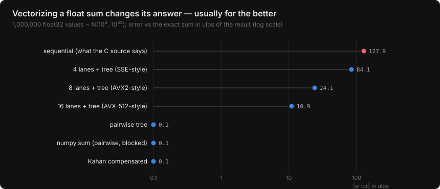

[← Back to Table of Contents](./README.md)

# Chapter 6 — Dependences & Aliasing: The Legality Question

> *"A compiler that refuses to vectorize your loop is not being timid. It has found an input on which the vector version gives a different answer, and it cannot prove you will never pass it."*

## Overview

Vectorizing a loop executes its iterations in a different order: $V$ at a time, loads before stores,
partial sums before totals. That is legal only if no observable result depends on the original
order. This chapter makes "observable result" precise. It covers the three kinds of data dependence
and the one-line rule for when a dependence distance permits $V$ lanes. It then covers aliasing, the
dependences the compiler cannot see, and floating-point reassociation, the dependence that is really
a numerical choice. Two labs let you move the arrows and the summation order yourself.

<div class="comic" style="--panels:4">
<div class="panel"><span class="cap">Monday, 10:02</span><span class="who">DEV</span><div class="bubble">Why won't you vectorize <code>add(float *a, float *b, int n)</code>? It's one line!</div><span class="who">COMPILER</span><div class="bubble r">What if <code>a == b + 1</code>?</div></div>
<div class="panel blue"><span class="who">DEV</span><div class="bubble">It never is!</div><span class="who">COMPILER</span><div class="bubble r">Then say so. I can read your types, not your mind. If they overlap, lane 1 must see what lane 0 just wrote.</div></div>
<div class="panel pink"><span class="cap">10:07</span><div class="bubble"><code>float *restrict a,</code><br><code>const float *restrict b</code></div><span class="sfx">PROMISE!</span></div>
<div class="panel night"><span class="who">COMPILER</span><div class="bubble r">remark: vectorized loop (vectorization width: 16)</div><span class="sfx go">VROOM</span><span class="cap">If you lied, the bug is yours now.</span></div>
</div>
<div class="genre-caption">The whole chapter in four panels. In practice compilers often emit a runtime overlap check instead of refusing, so <code>restrict</code> matters most when the check would be too complex or too expensive.</div>

---

## Three kinds of dependence

Two memory operations **depend** on each other when they touch the same location and at least one
writes. Order matters for three combinations:

| Name | Pattern | Example inside a loop | Reordering would… |
|---|---|---|---|
| **Flow** (true, read-after-write) | write, then a later read | `a[i+1] = a[i] * 2` | read the old value instead of the new one |
| **Anti** (write-after-read) | read, then a later write | `a[i] = a[i+1] * 2` | read a value that was already overwritten |
| **Output** (write-after-write) | two writes | `a[i % 4] = x[i]` | leave the wrong value last |

A dependence is **loop-carried** when the two operations are in *different* iterations. Only
loop-carried dependences constrain vectorization of that loop; dependences inside one iteration are
kept automatically, because each lane runs its own iteration's statements in order.

### Distance, and the one rule that matters

For a loop `a[i + W] = f(a[i + R])` the write in iteration $i$ and the read in iteration $j$ touch the
same element when $j + R = i + W$, i.e. when

$$d = j - i = W - R$$

$d$ is the **dependence distance**. Vectorized execution handles $V$ consecutive iterations as one
chunk: all $V$ loads, then all arithmetic, then all $V$ stores. A flow dependence ($d > 0$) breaks when the
reader lands in the same chunk as the writer, because the reader's load happened before the writer's
store. That happens exactly when $0 < d < V$. An anti dependence ($d < 0$) is always safe, because
every load in a chunk happens before every store. Hence:

$$\text{chunked vector execution is legal} \iff d \le 0 \;\text{ or }\; d \ge V$$

**Numerical check.** `a[i + 8] = 0.5 * a[i] + b[i]` has $d = 8$. With AVX2 fp32 ($V = 8$), lanes
$0..7$ read $a[0..7]$ and write $a[8..15]$; the next chunk reads $a[8..15]$ after they were written.
Legal. With AVX-512 ($V = 16$), lane 8 reads $a[8]$ in the *same* load that lane 0's store will
overwrite later. Illegal. The safe vector length is $d$ itself. `vzlab.deps.legal_analytic` implements
the rule and `test_analytic_legality_matches_simulation` checks it against a brute-force scalar-versus-chunked
simulation for 36 combinations.

<div class="lab" data-lab="deps"></div>

Try $R = 0, W = 1$: every arrow is red, and only $V = 1$ is legal. That is the prefix sum, and it is
why the `prefix` kernel ran at 0.62 ns/element under every compiler target we measured. Then try
$R = 4, W = 0$: blue anti-dependence arrows, legal at any width.

<div class="callout ponder"><span class="callout-title">Ponder</span>
<p>A safe vector length of $d$ means a loop can be legal on 128-bit SSE and illegal on 512-bit AVX-512.
Compilers handle this by choosing $V \le d$ when $d$ is known. What should a vector-length-agnostic ISA
(SVE, RISC-V V) do when the hardware width is unknown at compile time and $d$ is, say, 6? Hint: RISC-V's
<code>vsetvli</code> takes a requested length.</p>
</div>

---

## Aliasing: dependences you cannot see

Everything above assumed the compiler can *see* that `a[i+W]` and `a[i+R]` are the same array. With
pointers it often cannot:

```c
void scale(float *dst, const float *src, int n) {
    for (int i = 0; i < n; i++) dst[i] = 2.0f * src[i];
}
// Called as scale(a + 1, a, n), this IS a[i+1] = 2*a[i]: a distance-1 flow dependence.
```

The compiler has three options, and real compilers use all three:

| Strategy | What the compiler does | When |
|---|---|---|
| **Refuse** | keep the scalar loop | too many pointers, or bounds it cannot compute |
| **Version** | emit `if (dst + n <= src || src + n <= dst) vector_loop(); else scalar_loop();` | the common case for simple loops: a few instructions of overhead per call |
| **Trust** | vectorize unconditionally | the programmer promised with `restrict` (C), `__restrict__` (C++/CUDA), or the language guarantees it (Fortran arguments, Rust `&mut`) |

<div class="callout warn"><span class="callout-title">Trap</span>
<p><code>restrict</code> is a promise, not a check. Lying produces wrong results only on the inputs that
overlap, typically in production and never in the unit test. Use it on functions whose callers you control,
and assert non-overlap in debug builds.</p>
</div>

### The same question in NumPy and PyTorch

Array libraries face the identical problem whenever an output view overlaps an input view, and they
resolve it by **defining the semantics as if inputs were copied first**:

```python
import numpy as np
a = np.ones(8, dtype=np.float32)
a[1:] = a[:-1] * 2          # array semantics: read all of a[:-1], then write
print(a)                    # [1. 2. 2. 2. 2. 2. 2. 2.]

b = np.ones(8, dtype=np.float32)
for i in range(1, 8):       # loop semantics: each iteration sees the previous write
    b[i] = b[i - 1] * 2
print(b)                    # [  1.   2.   4.   8.  16.  32.  64. 128.]
```

Both outputs were produced by running this code (NumPy 2.5). The NumPy expression is *not* the
vectorized form of the loop. It is a different program, the one with the dependence removed. NumPy
detects the overlap and buffers the input; `np.multiply(a[:-1], 2, out=a[1:])` gives the same result.
PyTorch instead refuses partially overlapping in-place operations with
`RuntimeError: unsupported operation: some elements of the input tensor and the written-to tensor refer
to a single memory location`. Translating a loop into array code silently changes its meaning whenever
the loop had a flow dependence.

<div class="callout myth"><span class="callout-title">Myth</span>
<p>"Any loop can be rewritten in NumPy." Any loop <em>without a loop-carried flow dependence</em> can be
rewritten as a whole-array expression. A loop with one is a <strong>scan</strong> (a recurrence); NumPy has
special-purpose scans (<code>cumsum</code>, <code>cumprod</code>, <code>ufunc.accumulate</code>) and
nothing else. General recurrences need the associative-scan reformulation of Chapter 10.</p>
</div>

---

## Reductions: the dependence that is really a choice

`s = s + x[i]` has a distance-1 flow dependence on `s`, so by the rule above it is illegal for any
$V > 1$. Yet every compiler vectorizes sums. The trick is to **change the order of the additions**:
$V$ partial sums, one per lane, combined at the end. For integers this is exactly equivalent, because
integer addition wraps around modulo $2^b$ and is associative. For floating point it is not:

$$(a + b) + c \;\neq\; a + (b + c) \quad\text{in general, e.g.}\quad (10^8 + (-10^8)) + 1 = 1,\;\; 10^8 + (-10^8 + 1) = 0 \text{ in float32}$$

So for floats a vectorized reduction is a *different computation*, and the C and C++ standards (and
IEEE 754 semantics the compilers follow by default) forbid the compiler from substituting it unless
told it may. That is the remark clang printed for our `dot` kernel:

<div class="crt">
<div class="crt-bar">tty2 — clang -O3 -march=x86-64-v4 -Rpass-analysis=loop-vectorize bench.c</div>
<div class="crt-screen"><pre>
bench.c:58:34: <span class="bad">remark: loop not vectorized: cannot prove it is safe to reorder
               floating-point operations; allow reordering by specifying
               '#pragma clang loop vectorize(enable)' before the loop or by
               providing the compiler option '-ffast-math'.</span>
bench.c:65:3:  <span class="warn">remark: loop not vectorized: value that could not be identified
               as reduction is used outside the loop</span>              <span class="dim">&lt;- prefix sum</span>
bench.c:36:3:  remark: vectorized loop (vectorization width: 8, interleaved count: 4)
</pre></div>
</div>

Ways to grant permission, from narrowest to broadest:

| Permission | Scope | Notes |
|---|---|---|
| `#pragma omp simd reduction(+:s)` | one loop | portable (gcc, clang, icx with `-fopenmp-simd`); states exactly what may be reordered |
| `#pragma clang loop vectorize(enable)` | one loop | clang only |
| `-fassociative-math` (+ `-fno-signed-zeros -fno-trapping-math`) | translation unit | the minimal flag set gcc needs to reassociate |
| `-ffast-math` | translation unit | also assumes no NaN/Inf, enables reciprocal approximations, flushes denormals; can break `isnan` checks |
| write the partial sums yourself | source | explicit, portable, reviewable — what `dot_avx512_Kacc` does |

### How much does the answer change?

The companion code sums the same million float32 values, drawn from $\mathcal{N}(10^4, 10^3)$,
in six orders and compares each result with the exactly rounded sum (`reduction_orders` in
`results.json`):

<div class="fig"></div>

The in-order sum the C source asks for is the **least** accurate. Every running total is near
$10^{10}$, where one float32 ulp is 1024, so each addition rounds away part of a value near $10^4$.
Lane-split orders keep $V$ smaller running totals and lose less. NumPy's `np.sum` uses pairwise
summation and lands within an ulp. Vectorization usually *improves* accuracy, but it always changes
the bits, and that is what breaks bit-exact tests, golden-file comparisons and run-to-run
reproducibility across machines with different $V$.

<div class="lab" data-lab="reduce"></div>

<div class="callout field"><span class="callout-title">Field note</span>
<p>When a vectorized kernel "disagrees with the reference", first check whether the reference is the
in-order scalar sum. Compare both against a float64 or compensated (Kahan, <code>math.fsum</code>) sum before
blaming the kernel. Agreement to a few ulps relative to the <em>magnitude of the partial sums</em>, not the
final result, is the right tolerance when terms cancel.</p>
</div>

---

## Hidden dependences: calls, errno and exceptions

Some dependences are not on arrays at all.

- **Function calls** may read or write anything. A call to a non-inlined function in the loop body
  blocks vectorization unless the compiler has a vector version of it (`#pragma omp declare simd`,
  glibc's `libmvec` for `expf`/`sinf`, SLEEF).
- **`errno`.** C math functions set the global `errno` on domain errors, so `sqrtf(x[i])` writes global
  state on every iteration. We checked with gcc 13: a `sqrtf` loop reports *"not vectorized: control
  flow in loop … statement clobbers memory"* and vectorizes only with `-fno-math-errno` (which
  `-ffast-math` implies).
- **Floating-point exceptions.** Computing a value the scalar program would not have computed (both
  sides of a branch, a division in a lane that should be idle) can raise a flag the original never
  raised. Under the default `-ftrapping-math`, gcc treats that as observable. This is why it would not
  vectorize leaky ReLU for AVX2 but would for AVX-512, where masked arithmetic simply does not execute
  the idle lanes ([Chapter 8](./08_control_flow.md)).
- **`volatile`, atomics and I/O** are ordering constraints by definition.

---

## Breaking dependences

When the dependence is real, change the program, not the flags:

| Transformation | Before | After | Removes |
|---|---|---|---|
| **Scalar expansion** | `t = a[i]*2; b[i] = t + t*t;` with `t` reused across iterations | `t[i]` array or a per-lane register | false (output/anti) dependence on a scalar temporary |
| **Loop distribution** (fission) | one loop doing a vectorizable map and a recurrence | two loops | lets the map vectorize while the recurrence stays scalar |
| **Reduction recognition** | `s += x[i]` | $V$ partial sums | the flow dependence on `s` (needs reassociation for floats) |
| **Induction recognition** | `k = k + 3; y[i] = x[k];` | `y[i] = x[k0 + 3*i]` | a flow dependence on `k` |
| **Skewing** (wavefront) | 2-D recurrence (Chapter 4 figure) | loop over $t = i + j$ | dependences along the inner loop |
| **Associative scan** | `y[i] = a[i]*y[i-1] + b[i]` | log-depth combine of $(a, b)$ pairs | the recurrence itself, at extra arithmetic cost (Chapter 10) |
| **Algorithm change** | in-order softmax (max pass, sum pass, divide pass) | online softmax | passes over memory (Chapter 18) |

Each of these is in the [Technique Catalogue](./10_technique_catalogue.md) with its fact block.

---

## Testing legality yourself

The cheapest legality checker is a **differential test**: run the scalar and vectorized versions on
inputs designed to break the vector one, and compare.

```python
import numpy as np

def check(vec_fn, ref_fn, trials=200, rtol=1e-5):
    rng = np.random.default_rng(0)
    for _ in range(trials):
        n = int(rng.integers(1, 100))                 # include n < V and n not a multiple of V
        x = rng.standard_normal(n).astype(np.float32) * 10.0 ** rng.integers(-3, 4)
        np.testing.assert_allclose(vec_fn(x), ref_fn(x), rtol=rtol, atol=1e-6 * np.abs(x).sum())
```

Include lengths below the lane count and non-multiples of it (tails), overlapping views if the function
takes several arrays, NaN and Inf if the scalar code handles them, and magnitudes that cancel. The
`vzlab` tests do this for every pattern in the book.

---

## Key Takeaways

- Vectorizing reorders operations; it is legal only if no observable result depends on the original order.
- For a dependence of distance $d$, chunked vector execution is legal iff $d \le 0$ or $d \ge V$, so a loop can be legal at 128 bits and illegal at 512.
- Aliasing hides dependences; compilers refuse, insert runtime overlap checks, or trust `restrict`.
- Array expressions in NumPy have copy-the-inputs semantics: translating a loop with a flow dependence into NumPy silently computes a different result.
- Float reductions vectorize only with permission to reassociate; the result changes (here 128 ulps off in order versus 11–84 ulps lane-split) and is usually more accurate, but never bit-identical.
- Calls, `errno` and floating-point exceptions are hidden dependences; `-fno-math-errno` was the difference between scalar and vectorized `sqrtf` in gcc 13.

## Check Yourself

<details class="check"><summary>Is <code>a[i] = a[i + 3] + 1</code> vectorizable with V = 16?</summary>
Yes. Here W = 0 and R = 3, so d = W − R = −3 ≤ 0: an anti dependence (element a[k] is read in iteration k − 3 and overwritten later, in iteration k). All loads of a chunk happen before its stores, so every lane reads the old value, exactly as the scalar loop does.
</details>

<details class="check"><summary>Why does integer <code>sum += x[i]</code> vectorize at <code>-O3</code> but float <code>sum += x[i]</code> does not?</summary>
Two's-complement integer addition is associative (overflow wraps identically in any order), so partial sums give the exact same result. Floating-point addition rounds after each operation, so reordering changes the result; compilers need explicit permission (<code>-fassociative-math</code>, an OpenMP reduction clause, or a pragma).
</details>

<details class="check"><summary>A colleague replaced <code>for i in range(1, n): x[i] = x[i-1] * r + u[i]</code> with <code>x[1:] = x[:-1] * r + u[1:]</code>. What happened?</summary>
The loop is a first-order linear recurrence (distance-1 flow dependence). The NumPy version reads all of the old <code>x[:-1]</code> before writing, so each element uses the <em>original</em> previous value, not the updated one: a different, wrong result except for the first element. A correct vectorization needs an associative scan, or <code>scipy.signal.lfilter</code> for this specific recurrence.
</details>

<details class="check"><summary>When is <code>-ffast-math</code> the wrong way to get a reduction vectorized?</summary>
When the code relies on NaN/Inf semantics (it assumes they never occur, so <code>isnan</code> checks may be removed), on signed zeros, or on exact division; or when the flag would apply to a whole file with other sensitive code. A per-loop <code>#pragma omp simd reduction(+:s)</code> or hand-written partial sums grant only the permission needed.
</details>

## References

| Source | Authors / Org, Year | Link | What this chapter takes from it |
|--------|--------------------|------|--------------------------------|
| Optimizing Compilers for Modern Architectures: A Dependence-based Approach | Allen & Kennedy, 2001 | Morgan Kaufmann | Dependence kinds, distance vectors, loop transformations |
| The Parallel Execution of DO Loops | Lamport, CACM 1974 | doi:10.1145/360827.360844 | Early formal treatment of loop reordering legality |
| What Every Computer Scientist Should Know About Floating-Point Arithmetic | Goldberg, ACM Computing Surveys 1991 | doi:10.1145/103162.103163 | Non-associativity of floating-point addition |
| Accuracy and Stability of Numerical Algorithms, 2nd ed., ch. 4 | Higham, SIAM 2002 | — | Error bounds for sequential, pairwise and compensated summation |
| Auto-Vectorization in LLVM | LLVM Project | llvm.org/docs/Vectorizers.html | Runtime alias checks, reduction handling, remarks |
| GCC Optimize Options (`-fassociative-math`, `-fmath-errno`, `-ftrapping-math`) | GNU | gcc.gnu.org/onlinedocs | Flags that grant reordering permission |
| NumPy universal functions: overlap handling | NumPy | numpy.org/doc | Copy-as-if semantics for overlapping operands |
| This book's code and measurements | `code/vzlab/deps.py`, `reduce.py`; `results.json` | [repo](https://github.com/karam-nus/vectorization) | Legality rule tests; `reduction_orders`; clang remarks in `remarks.txt` |

---

**Next:** [Chapter 7 — Memory Is the Real Vector](./07_memory_layout.md) — legal is not the same as fast; the bytes decide.
