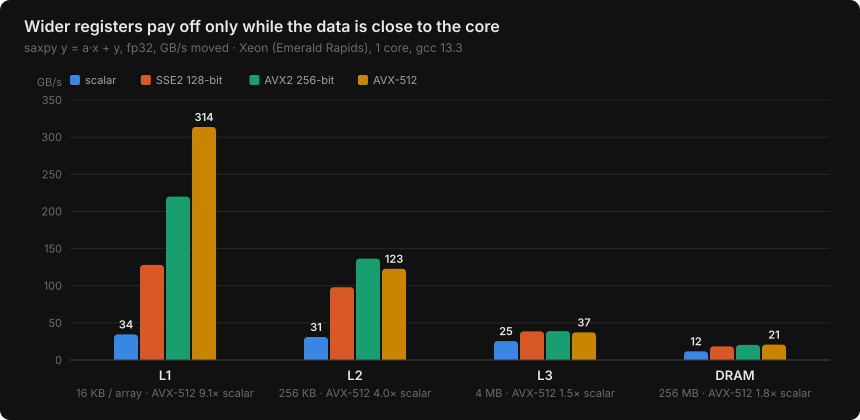
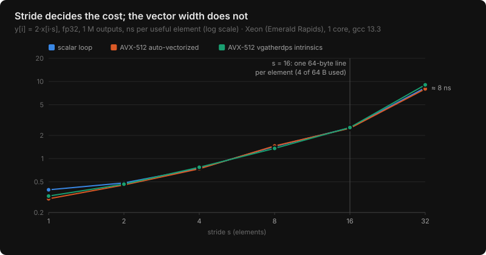

[← Back to Table of Contents](./README.md)

# Chapter 7 — Memory Is the Real Vector

> *"The processor does not load elements. It loads cache lines, and charges you for every one you touch."*

## Overview

A vector instruction is only as fast as the data that feeds it. Hardware moves memory in fixed
blocks: 64-byte cache lines on CPUs, 32-byte sectors on NVIDIA GPUs, DRAM bursts below that. A vector
load is cheap exactly when its $V$ elements sit in one block. This chapter measures what happens when
they do not, because of stride, layout or indirection. It also measures how the benefit of wider
registers drains away as data moves further from the core. The conclusion shapes everything after
it: **choose the layout first; the vectorization follows.**

contiguous<i class="use"></i><i class="use"></i><i class="use"></i><i class="use"></i><i class="use"></i><i class="use"></i><i class="use"></i><i class="use"></i><i class="use"></i><i class="use"></i><i class="use"></i><i class="use"></i><i class="use"></i><i class="use"></i><i class="use"></i><i class="use"></i>1 line → 16 lanes

AoS, 3 of 8<i class="x"></i><i class="y"></i><i class="z"></i><i class="load"></i><i class="load"></i><i class="load"></i><i class="load"></i><i class="load"></i><i class="x"></i><i class="y"></i><i class="z"></i><i class="load"></i><i class="load"></i><i class="load"></i><i class="load"></i><i class="load"></i><i class="x"></i><i class="y"></i><i class="z"></i><i class="load"></i><i class="load"></i><i class="load"></i><i class="load"></i><i class="load"></i><i class="x"></i><i class="y"></i><i class="z"></i><i class="load"></i><i class="load"></i><i class="load"></i><i class="load"></i><i class="load"></i>2 lines → 4 particles · 37.5 % useful

stride 16<i class="use"></i><i class="load"></i><i class="load"></i><i class="load"></i><i class="load"></i><i class="load"></i><i class="load"></i><i class="load"></i><i class="load"></i><i class="load"></i><i class="load"></i><i class="load"></i><i class="load"></i><i class="load"></i><i class="load"></i><i class="load"></i><i class="use"></i><i class="load"></i><i class="load"></i><i class="load"></i><i class="load"></i><i class="load"></i><i class="load"></i><i class="load"></i><i class="load"></i><i class="load"></i><i class="load"></i><i class="load"></i><i class="load"></i><i class="load"></i><i class="load"></i><i class="load"></i>2 lines → 2 lanes · 6.25 % useful

gather<i class="load"></i><i class="load"></i><i class="load"></i><i class="load"></i><i class="load"></i><i class="use"></i><i class="load"></i><i class="load"></i><i class="load"></i><i class="load"></i><i class="load"></i><i class="load"></i><i class="load"></i><i class="load"></i><i class="load"></i><i class="load"></i><i></i><i></i><i></i><i></i><i></i><i></i><i></i><i></i><i></i><i></i><i></i><i></i><i></i><i></i><i></i><i></i><i class="load"></i><i class="load"></i><i class="load"></i><i class="load"></i><i class="load"></i><i class="load"></i><i class="load"></i><i class="load"></i><i class="load"></i><i class="load"></i><i class="load"></i><i class="load"></i><i class="load"></i><i class="use"></i><i class="load"></i><i class="load"></i>1 line per lane, wherever it lands

fp32 elements in 64-byte cache lines. Cyan or coloured: used. Grey: moved but unused. The lane count of the instruction is irrelevant to the bytes moved; the layout decides.

---

## The memory hierarchy sets the ceiling

The same `saxpy` loop ($y = a x + y$: 2 FLOP and 12 bytes per element) compiled four ways and run on
arrays sized to live in each level of the hierarchy (`saxpy_memory_levels`, one core):

| Data lives in | Scalar | SSE2 | AVX2 | AVX-512 | AVX-512 over scalar | AVX-512 over SSE2 |
|---|:---:|:---:|:---:|:---:|:---:|:---:|
| **L1** (16 KB per array) | 34.5 | 128.1 | 220.0 | 313.7 GB/s | 9.1× | 2.4× |
| **L2** (256 KB) | 31.0 | 98.1 | 136.6 | 122.8 GB/s | 4.0× | 1.25× |
| **L3** (4 MB) | 25.5 | 38.5 | 39.0 | 37.2 GB/s | 1.5× | 0.97× |
| **DRAM** (256 MB) | 11.7 | 18.3 | 20.3 | 20.8 GB/s | 1.8× | 1.14× |

Two things to read off it. First, **wider registers stop mattering the moment the data leaves L2.**
From L3 and DRAM, a 128-bit loop already issues loads faster than the memory system delivers lines.
Second, even the scalar loop is not free from DRAM. At 11.7 GB/s it is limited by how many cache
misses one core can keep in flight, and vector loads help by issuing fewer, wider requests. That
explains the remaining 1.8×.

Ponder

This machine's L3 is 260 MB, so the "DRAM" row needed 256 MB arrays to escape it. Most real tensors
in an ML pipeline are touched once per pass and are far larger than L2. How many of your elementwise
operations run from L1 or L2? If the answer is "almost none", the most valuable optimisation is to touch
each byte fewer times (fusion, Chapter 18), not to widen the arithmetic.

---

## Stride: the cost of every skipped byte

`y[i] = 2 * x[i*s]` reads one float out of every $s$. Cost per useful element, 1 M outputs
(`stride_sweep`):

The three lines are nearly on top of each other. The AVX-512 auto-vectorized loop and the hand-written
`vgatherdps` loop are no faster than scalar code at any stride, because the bottleneck is lines
touched, not instructions issued:

$$\text{lines per useful element} = \min\!\left(1,\; \frac{s \cdot e}{64\ \text{B}}\right)$$

Numerical check: at $s = 16$, fp32 ($e = 4$ B) gives $16 \cdot 4 / 64 = 1$ line per element, the
point at which every load is a separate cache line. The measured cost there is 2.5 ns per element,
6.4× stride 1. Beyond $s = 16$ the cost keeps rising (8.0–9.1 ns at $s = 32$) although the line count
per element is already 1. The array is now 128 MB, so the accesses miss further down the hierarchy,
and the hardware prefetcher, which follows strides only within a page, helps less.

`vzlab.memory.lines_touched` and the lab below count lines for any pattern.

---

## Layout: arrays of structs versus structs of arrays

The most common layout decision in practice. A particle has eight float fields; the update touches three
positions and three velocities:

<table class="sheet"><caption>AoS — one row per particle (memory order: across, then down)</caption><tr><th></th><th>x</th><th>y</th><th>z</th><th>vx</th><th>vy</th><th>vz</th><th>m</th><th>q</th></tr><tr><th>0</th><td class="s">x0</td><td class="s">y0</td><td class="s">z0</td><td class="s">vx0</td><td class="s">vy0</td><td class="s">vz0</td><td class="g">m0</td><td class="g">q0</td></tr><tr><th>1</th><td class="s">x1</td><td class="s">y1</td><td class="s">z1</td><td class="s">vx1</td><td class="s">vy1</td><td class="s">vz1</td><td class="g">m1</td><td class="g">q1</td></tr><tr><th>2</th><td class="s">x2</td><td class="s">y2</td><td class="s">z2</td><td class="s">vx2</td><td class="s">vy2</td><td class="s">vz2</td><td class="g">m2</td><td class="g">q2</td></tr></table>
→
<table class="sheet"><caption>SoA — one column per field (memory order: down, then across)</caption><tr><th></th><th>x[]</th><th>y[]</th><th>z[]</th><th>vx[]</th></tr><tr><th>0</th><td class="s">x0</td><td class="s">y0</td><td class="s">z0</td><td class="s">vx0</td></tr><tr><th>1</th><td class="s">x1</td><td class="s">y1</td><td class="s">z1</td><td class="s">vx1</td></tr><tr><th>2</th><td class="s">x2</td><td class="s">y2</td><td class="s">z2</td><td class="s">vx2</td></tr><tr><th>3</th><td class="s">x3</td><td class="s">y3</td><td class="s">z3</td><td class="s">vx3</td></tr></table>

AoS stores a spreadsheet row-major: a vector load along "x" must skip 7 fields. SoA stores it column-major: 16 consecutive x values are one load. Ghosted cells are fields this kernel never uses but AoS still drags through the cache.

Measured, n = 4096 particles in L1 (`width_ladder_L1`, ns per particle):

| Target | AoS (`step_aos`) | SoA (`step_soa`) | SoA advantage |
|---|:---:|:---:|:---:|
| **scalar** | 1.27 | 1.08 | 1.2× |
| **SSE2** | 1.37 | 0.35 | 3.9× |
| **AVX2** | **2.52** | 0.26 | 9.5× |
| **AVX-512** | 1.15 | 0.30 | 3.9× |

The AVX2 AoS row is the instructive one. gcc *did* vectorize it, using permutes to de-interleave
x, y and z from the 32-byte struct, and the result was **2× slower than scalar**. Shuffle-port pressure
and the extra loads cost more than the wider arithmetic saved. AVX-512's richer two-source permutes
recover some of it, but SoA wins at every width because it never needs a shuffle.

| Layout | Vector loads | Wasted bytes | Pays off when | Seen in |
|---|---|---|---|---|
| **AoS** `struct {x,y,z,…} p[n]` | gathers or de-interleaving shuffles | every unused field | you access whole records, rarely in bulk | most object-oriented code, row-oriented databases |
| **SoA** `struct {x[n], y[n], …}` | plain contiguous loads | none for used fields | bulk passes over a few fields | columnar databases, physics engines, ISPC, Arrow |
| **AoSoA** `struct {x[16], y[16], …} p[n/16]` | contiguous within a block | none; locality between fields preserved | both bulk passes and per-record locality matter | oneDNN blocked layouts, many GPU kernels, game engines |

Myth

"A struct of arrays is always better." SoA turns one record access into several cache lines, one per
field, so random access to whole records gets slower. AoSoA with a block equal to the vector width keeps
both properties. It is exactly what oneDNN's <code>nChw16c</code> layout is for convolution activations:
16 channels of one pixel stored together, the pixels in order.

---

## Tensor layouts are the same decision

A 4-D activation tensor has an axis order, and that order decides which axis is contiguous:

| Layout | Contiguous axis | Vectorizes naturally along | Used by |
|---|---|---|---|
| **NCHW** | W (width) | pixels of one channel | PyTorch default, cuDNN historically |
| **NHWC** (channels-last) | C (channels) | channels of one pixel: the reduction axis of a 1×1 conv or a GEMM | TensorFlow default, tensor-core convolutions, mobile runtimes |
| **NCHW16c** (blocked) | 16 channels inside, then W | 16 channels at a time with spatial locality | oneDNN on x86 |

NVIDIA's performance guidance recommends NHWC for tensor-core convolutions because it makes the
channel dimension, the one the implicit GEMM reduces over, contiguous. In PyTorch,
`model.to(memory_format=torch.channels_last)` changes the strides without changing the shape. That is
exactly a layout change, invisible to the model code. Check it with `x.stride()` (Chapter 4).

### Loop order is layout seen from the other side

For row-major matrices, the matrix multiply loop order decides whether the inner loop walks a row
(contiguous) or a column (stride $N$). Same arithmetic, $N = 512$, fp32 (`matmul_loop_order`):

| Loop order | Inner loop is | Scalar | AVX-512 | AVX-512 `-ffast-math` |
|---|---|:---:|:---:|:---:|
| **ijk** | a reduction down a column of B (stride 512) | 2.08 | 2.10 | 2.00 GFLOP/s |
| **ikj** | a map along a row of B and C (stride 1) | 5.17 | **46.6** | 39.3 GFLOP/s |

Swapping two loops was worth 22×, and it was the precondition for vectorization: `ijk` stays scalar even
with `-ffast-math`, because its inner loop is strided. This is **loop interchange**, the oldest layout
fix there is ([Chapter 10](./10_technique_catalogue.md)).

---

## GPUs: coalescing is the memory strip for warps

On a GPU the 32 threads of a warp issue their loads together, and the memory system merges
(coalesces) them into 32-byte sectors. The memory-strip arithmetic is identical, with 32-byte boxes:

| Thread $t$ reads element | Sectors per warp (fp32) | Efficiency | `vzlab.memory.warp_sectors` |
|---|:---:|:---:|:---:|
| $t$ (contiguous) | 4 | 100 % | 4 |
| $2t$ | 8 | 50 % | 8 |
| $8t$ | 32 | 12.5 % | 32 |
| $32t$ (a column of a 32-wide row-major tile) | 32 | 12.5 % | 32 |
| random | up to 32 | ≥ 12.5 % | — |

The classic fix for column access is to load the tile **row-wise into shared memory** (coalesced) and
read it column-wise from there, where the constraint is different: 32 *banks*, so a column of a 32-wide
tile hits one bank 32 times unless the tile is padded to 33 columns ([Chapter 15](./15_gpus_simt.md)).

---

## Gathers: legal, general and slow

Hardware gather (`vgatherdps`, SVE `ld1w` with vector offsets, RISC-V `vluxei32`) makes indirect loads
vectorizable, but it does not make them cheap. Every lane is a separate cache access. In our stride
experiment the gather intrinsic was within ±10 % of scalar code at every stride. Gathers pay when they
let the *rest* of the loop vectorize (a lookup table feeding heavy arithmetic), not when the gather is
the loop.

| If the gather is… | Better option |
|---|---|
| a small lookup table (≤ 16–64 entries of bytes) | register shuffles: `pshufb`, `vpermb`, `tbl` |
| a fixed pattern (interleaved fields, every k-th element) | de-interleaving loads (`vld3`, NEON) or re-layout to SoA |
| embedding rows (each index fetches a long contiguous row) | vectorize *along the row*, loop over indices in scalar — each row is a contiguous load |
| truly random scalars | sort or bucket the indices first so nearby lanes hit nearby lines |

Field note

Embedding lookups look like the worst case (random indices) but are usually fine: each index fetches a
whole row of 64–4096 contiguous values. The vector runs along the row, the index loop is scalar, and the
cost is one cache-miss latency per row, overlapped across rows by the out-of-order engine or by many GPU
warps. Paged KV caches work the same way, page by page.

---

## Alignment, streaming stores and prefetching

- **Alignment.** A 64-byte AVX-512 load from an address that is not a multiple of 64 spans two cache
  lines *every time*; a 16-byte SSE load does so one time in four at random offsets. Allocate with
  64-byte alignment (`posix_memalign`, `std::aligned_alloc`; PyTorch's CPU allocator already aligns to
  64 bytes, while NumPy typically gets 16-byte alignment from `malloc`) and peel a few scalar iterations
  if a slice starts unaligned.
- **Non-temporal stores** (`_mm512_stream_ps`, `movntps`) write around the cache. For outputs larger than
  the last-level cache that will not be re-read soon, they skip reading each line before overwriting it
  (the read-for-ownership): half the traffic of a pure write stream, a third of a copy.
- **Prefetching.** Hardware prefetchers follow sequential and simple strided streams within a 4 KB page.
  Software prefetch (`_mm_prefetch`) helps irregular but predictable access, such as the next few gather
  indices; it rarely helps a contiguous loop.

---

## Key Takeaways

- Hardware moves whole cache lines (64 B on CPUs, 32-byte sectors on NVIDIA GPUs); cost follows lines touched, not lanes filled.
- Wider registers lost their advantage once data left L2: AVX-512 saxpy was 9.1× scalar from L1, 1.5× from L3 and 1.8× from DRAM, and only 1.14× over SSE2 from DRAM.
- Stride costs the same with scalar, auto-vectorized and gather code: about 0.3 ns per element at stride 1, 2.5 ns at stride 16.
- SoA beat AoS at every width; vectorized AoS with AVX2 was 2× *slower* than scalar because of shuffles.
- Tensor layouts (NCHW, NHWC, blocked) and matmul loop order are the same decision: which axis is contiguous. Interchanging two loops was worth 22× in matmul.
- Gathers make indirect loops legal to vectorize, not fast; turn small lookups into shuffles and long-row lookups into contiguous loads.

## Check Yourself

Why can AVX-512 saxpy from DRAM not be 16× faster than scalar saxpy from DRAM?

From DRAM the loop moves 12 bytes per element and one core can pull only about 21 GB/s. Even SSE2 code issues loads fast enough to nearly saturate that; extra lanes reduce instruction count but not bytes. The measured ceiling was 20.8 GB/s for AVX-512 versus 18.3 for SSE2.

A kernel reads <code>x[:, 0]</code> from a row-major [N, 64] float32 matrix. How many cache lines per useful element, and what would you change?

Each row is 256 bytes, so consecutive elements of column 0 are 256 bytes apart: one 64-byte line per useful element (6.25 % efficiency). Transpose or store the matrix column-major for this access, or process whole rows (all 64 columns) per pass so every fetched line is fully used.

What is AoSoA, and what problem of SoA does it solve?

Array of structs of arrays: records grouped in blocks of V, each block storing each field contiguously. It keeps SoA's contiguous vector loads within a block while keeping all fields of a record close in memory, so whole-record access does not touch one distant cache line per field.

On a GPU, thread t reads <code>A[t * 32]</code> from a row-major 32 × 32 fp32 tile. How many sectors per warp, and what is the standard fix?

32 sectors (each thread hits a different 32-byte sector), 12.5 % efficiency. Load the tile cooperatively row-wise into shared memory (4 sectors per row), then read columns from shared memory; pad the tile to 33 columns to avoid bank conflicts.

## References

| Source | Authors / Org, Year | Link | What this chapter takes from it |
|--------|--------------------|------|--------------------------------|
| What Every Programmer Should Know About Memory | Drepper, 2007 | akkadia.org/drepper/cpumemory.pdf | Cache lines, prefetching, non-temporal stores |
| Intel 64 and IA-32 Architectures Optimization Reference Manual | Intel, 2024 | intel.com | Line splits, streaming stores, prefetcher behaviour |
| CUDA C++ Best Practices Guide — Coalesced Access to Global Memory | NVIDIA | docs.nvidia.com/cuda | Sector-based coalescing, shared-memory transpose |
| NVIDIA Deep Learning Performance — Convolutional Layers User's Guide | NVIDIA | docs.nvidia.com/deeplearning/performance | NHWC for tensor-core convolutions |
| oneDNN Developer Guide — Understanding Memory Formats | Intel | oneapi-src.github.io/oneDNN | Blocked layouts such as nChw16c |
| PyTorch channels_last memory format tutorial | PyTorch | pytorch.org/tutorials | Layout change by strides only |
| This book's measurements | `tools/measurements/results.json` | [repo](https://github.com/karam-nus/vectorization/tree/main/tools/measurements) | `saxpy_memory_levels`, `stride_sweep`, `width_ladder_L1` (AoS/SoA), `matmul_loop_order` |

---

**Next:** [Chapter 8 — Masks, Predication, Divergence & Tails](./08_control_flow.md) — what to do when not every lane wants the same thing.
