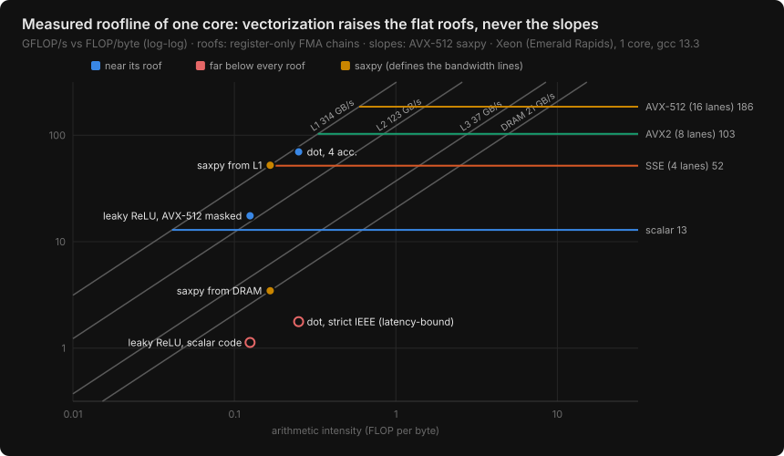
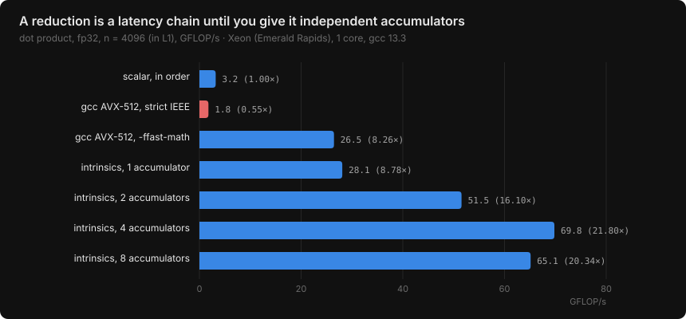

[← Back to Table of Contents](./README.md)

# Chapter 9 — Is It Worth It? Roofline, Amdahl & Real Ceilings

> *"The register is sixteen lanes wide. The speedup is whatever is left after memory, tails, shuffles and the rest of the program have taken their cut."*

## Overview

Legality says you *may* vectorize. Profitability says whether you *should*. Three ceilings decide it,
in this order. **Memory**: is the loop starved of bytes? This is the roofline. **The program**: how much
of the runtime is in the loop at all? This is Amdahl. **The overheads**: tails, shuffles,
reductions, gathers, frequency and dispatch. This chapter derives the first two, measures all three on
one core, and ends with a five-minute estimate to do before writing any vector code.

SPEEDUP STATEMENT

saxpy · fp32 · 64 M elements from DRAM

ideal: 16 lanes16.0×

memory-bound: bytes, not lanes−14.2×

&nbsp;&nbsp;DRAM ~21 GB/s, 12 B / elem

tail (n multiple of 16)−0.0×

YOU RECEIVED1.8×

measured, Xeon (Emerald Rapids), 1 core avx512 vs scalar, saxpy_memory_levels

SPEEDUP STATEMENT

dot product · fp32 · 4096 elements in L1

ideal: 16 lanes16.0×

no reassociation allowed−15.5×

&nbsp;&nbsp;16 serial adds + shuffles / iter

YOU RECEIVED0.55×

with -ffast-math8.3×

with 4 accumulators21.8×

a "vectorized" loop slower than scalar; dot_accumulators_L1

Two statements from the same core. The first was robbed by memory, the second by a dependence the compiler was not allowed to break. 21.8× exceeds 16× because the scalar baseline was itself latency-bound.

---

## Ceiling 1 — The roofline

A kernel needs some number of floating-point operations and some number of bytes from a given level of
memory. Their ratio is its **arithmetic intensity**:

$$I = \frac{\text{FLOP}}{\text{bytes moved}}$$

In a time $t$ the machine can do at most $P_{\text{peak}} \cdot t$ FLOP and move at most $B \cdot t$
bytes, so the attainable rate is

$$P(I) = \min\left(P_{\text{peak}},\; I \cdot B\right)$$

The two regimes meet at the **ridge point** $I^\ast = P_{\text{peak}} / B$. Below it the kernel is
memory-bound and its speed is $I \cdot B$, independent of $P_{\text{peak}}$.

**This is the key fact for vectorization.** Vectorizing raises $P_{\text{peak}}$ (the flat roof). It
does not change $B$ (the slope). So vectorization can only help a kernel whose intensity is above the
*scalar* ridge point.

**Numerical check with measured ceilings.** Scalar peak 12.9 GFLOP/s; AVX-512 peak 185.8 GFLOP/s;
DRAM bandwidth 21 GB/s, L1 bandwidth 314 GB/s (both measured with saxpy, one core):

| Data in | Scalar ridge $I^\ast$ | AVX-512 ridge $I^\ast$ | Vectorization can help only if… |
|---|:---:|:---:|---|
| **DRAM** | 12.9 / 21 = 0.61 FLOP/B | 185.8 / 21 = 8.8 FLOP/B | $I > 0.61$; the full 14× needs $I > 8.8$ |
| **L1** | 12.9 / 314 = 0.041 FLOP/B | 185.8 / 314 = 0.59 FLOP/B | $I > 0.041$, almost always |

saxpy has $I = 2/12 = 0.167$ FLOP/B. From DRAM that is far below the scalar ridge (0.61), so the
roofline predicts essentially no gain from wider arithmetic. We measured 1.8×, and that came from
better memory-level parallelism (fewer, wider load requests), not from lanes. From L1 the same kernel
sits above the scalar ridge, and vectorization gave 9×.

### The vectorization ceiling at a given intensity

Dividing the vector roofline by the scalar one gives the best possible speedup from vectorizing a
kernel of intensity $I$ whose data lives at bandwidth $B$:

$$S_{\max}(I) = \frac{\min(P_{\text{vec}},\, I B)}{\min(P_{\text{scalar}},\, I B)}$$

| Kernel | $I$ (FLOP/B) | $S_{\max}$ from DRAM | $S_{\max}$ from L1 | Measured, L1 |
|---|:---:|:---:|:---:|:---:|
| **leaky ReLU** | 0.125 | 1.0× | 3.0× | 15.6× * |
| **saxpy** | 0.167 | 1.0× | 4.1× | 9.0× * |
| **dot product** | 0.25 | 1.0× | 6.1× | 21.8× * |
| **softmax, fused one pass** | ≈ 0.6 | 1.0× | 14.4× | — |
| **GEMM tile, 256 × 256** | ≈ 40 | 14.4× | 14.4× | — |

\* *Measured speedups above $S_{\max}$ are not a contradiction. The model assumes the scalar code runs at
the scalar roof, but the measured scalar loops did not: branch mispredictions (leaky ReLU), a latency
chain (dot) and loop overhead kept them far below 12.9 GFLOP/s. The roofline bounds performance from
above; it says nothing about how far below the roof a given implementation sits.*

Ponder

An LLM decoding one token at batch size 1 multiplies every weight matrix by a single vector: about
2 FLOP per weight, and each fp16 weight is 2 bytes, so I ≈ 1 FLOP/B against HBM. Where does that put it on a
GPU whose ridge point is around 300 FLOP/B? What happens to I if you serve 64 requests at once, so each
weight read is used 64 times? You have just derived why LLM serving is all about batching (Chapter 19).

---

## Ceiling 2 — Amdahl

If a fraction $f$ of the runtime is sped up by $s$ and the rest is unchanged, the whole program speeds up by

$$S = \frac{1}{(1 - f) + f/s}$$

and never by more than $1/(1-f)$, however large $s$ gets.

**Numerical check.** A data pipeline spends 70 % of its time in a loop you vectorize at 9×:
$S = 1 / (0.3 + 0.7/9) = 1 / 0.378 = 2.65\times$. Even infinite vector width gives only $1/0.3 = 3.3\times$.
`vzlab.perfmodel.amdahl(0.9, 16) == 6.4` is one of the companion tests.

Two practical consequences follow:

1. **Profile first.** The loop you are about to vectorize must be a large $f$, measured, not guessed.
2. **After vectorizing, the profile changes.** The 30 % you ignored becomes 79 % of the new runtime in the
   example above. The next optimisation is almost never another round on the same loop.

---

## Ceiling 3 — The overheads that eat the middle

Between "it is above the ridge" and "it reached $V\times$" sit the costs this book keeps meeting:

| Overhead | Typical size | Shows up when | Chapter |
|---|---|---|:---:|
| **Tail** | up to $V-1$ extra iterations | $n$ small or not a multiple of $V$ | [8](./08_control_flow.md) |
| **Masked lanes / divergence** | up to 50 % of lanes for a 50/50 branch | branches inside the loop | [8](./08_control_flow.md) |
| **Shuffles and permutes** | 1 port on many cores | AoS data, transposes, interleaving | [7](./07_memory_layout.md) |
| **Horizontal reductions** | $\log_2 V$ dependent steps | reductions done per iteration instead of once | [3](./03_lanes_and_registers.md) |
| **Latency chains** | 4-cycle FMA latency per step | a single accumulator | [14](./14_explicit_simd.md) |
| **Gathers / scatters** | one access per lane | indirect access | [7](./07_memory_layout.md) |
| **Layout conversion** | a full pass over the data | the data is in the wrong layout for the kernel | [7](./07_memory_layout.md) |
| **Frequency reduction** | small on recent server cores | heavy 512-bit use on older Intel parts | below |
| **Dispatch / launch** | µs per call | NumPy calls on small arrays, GPU kernel launches | [11](./11_array_programming.md), [15](./15_gpus_simt.md) |

Note — AVX-512 and clock speed

Early AVX-512 server parts (Skylake-SP) lowered core frequency under sustained 512-bit work, which
could make AVX-512 code slower than AVX2 for light vector use mixed with scalar code. Measurements on
Sapphire and Emerald Rapids report much smaller effects; Phoronix measured a peak of 2.95 GHz with
AVX-512 versus 3.01 GHz without on an Emerald Rapids Xeon. Our own register-only test reached the full
16/8 = 1.80× of AVX-512 over AVX2 (185.8 vs 103.1 GFLOP/s). Measure on your part; do not assume either way.

---

## Latency-bound: under the roof for a different reason

The roofline has two lines, but kernels can sit far below both. The strict-IEEE dot product ran at
1.8 GFLOP/s at $I = 0.25$ in L1, where the bandwidth roof allows 78. Neither memory nor peak compute is the
limit. A single chain of dependent additions is: every add waits 4 cycles for the previous one. The
roofline says only that something other than its two ceilings is in the way, and the piano roll
([Chapter 4](./04_seeing_vectors.md)) names it.

$$\text{chains needed} = \text{latency} \times \text{issue rate} = 4 \times 2 = 8$$

`vzlab.perfmodel.fma_accumulators_needed(4, 2) == 8`. Measured: 1 accumulator 28.1 GFLOP/s, 2 reached
51.6, 4 reached 69.8, 8 reached 65.1. Four were enough here because two loads per FMA saturate the load
ports first. That is a third ceiling, load throughput, which a finer roofline would draw as its own line.

---

## The five-minute profitability estimate

Before writing a line of vector code:

1. **Measure the baseline** and the fraction $f$ of total runtime in the loop.
2. **Count FLOP and bytes per element**, and decide which memory level the data comes from (is it touched
   again soon? does it fit in L2?). That gives $I$ and $B$.
3. **Place it on the roofline.** If $I$ is below the scalar ridge for that level, stop: vectorizing
   arithmetic will not help. Reduce bytes instead, by fusing passes, using smaller types or tiling for reuse.
4. **Bound the gain**: $S_{\max}(I)$ for the loop, then Amdahl with $f$ for the program.
5. **Subtract the overheads** you can see from the table above: tails if $n$ is short, shuffles if AoS,
   divergence if branchy.

If the estimate is under about 1.3×, the effort is usually better spent elsewhere.

---

## Measuring honestly

Speedup claims fail more often from bad measurement than from bad code. What this book's numbers do
(see `tools/measurements/README.md`):

- **Pin to one core** (`taskset -c 1`) and report thread count. Before pinning, repeated runs of the
  same kernel on this cloud VM differed by up to 1.6×.
- **Warm up, repeat, take the best of several trials** for microbenchmarks (best of 5 timed trials,
  best of 3 processes). Use the median instead when you care about typical rather than achievable time.
- **Name the size and the memory level**: the same kernel's speedup ranged from 9.1× to 1.5× across
  levels.
- **Keep results alive**: print a checksum so the compiler cannot delete the work.
- **Compare like with like**: same compiler, same flags except the one under test, same data.

Field note

Report speedups together with the absolute rate and the relevant ceiling: "9.0× over scalar,
52 GFLOP/s, at the L1-bandwidth roof". A speedup alone hides whether you are at 5 % or 95 % of what the
machine can do, and only the second tells you to stop optimising.

---

## Key Takeaways

- Vectorization raises the compute roof and never the bandwidth slope; it helps only kernels above the *scalar* ridge point for the memory level their data comes from.
- On this core the scalar ridge was 0.61 FLOP/B from DRAM and 0.041 from L1: elementwise kernels can gain from vectorization in cache but not from DRAM.
- Amdahl caps the program-level gain at $1/(1-f)$; profile before and after, because the bottleneck moves.
- Overheads (tails, masks, shuffles, reductions, gathers, layout changes, frequency, dispatch) explain the gap between $V\times$ and what you get.
- A kernel far below both roofs is latency- or issue-bound; independent accumulators (8 = 4-cycle latency × 2 ports) are the fix for reductions.
- Report speedup together with the absolute rate and the ceiling it is under.

## Check Yourself

A kernel does 1 FLOP per 8 bytes and its data streams from DRAM at 21 GB/s. Scalar peak is 12.9 GFLOP/s. What is the most vectorization can give?

I = 0.125 FLOP/B; I·B = 2.6 GFLOP/s, below the scalar peak, so the kernel is memory-bound even as scalar code. S_max ≈ 1×. Any gain comes from memory-level parallelism, not lanes; the real lever is moving fewer bytes.

A 2048 × 2048 fp32 matmul has I ≈ 2N³ / (3·4·N²) FLOP/B if each matrix is read once. Is it memory-bound from DRAM on this core?

I ≈ 2·2048 / 12 ≈ 341 FLOP/B, far above the AVX-512 ridge of 8.8, so it can be compute-bound, provided the implementation actually reuses data (tiling). A naive loop order re-reads B from memory and has a much lower effective intensity, as the ijk measurement (2 GFLOP/s) showed.

Your vectorized loop is 10× faster but the program is only 1.5× faster. What fraction of the original runtime was the loop?

1.5 = 1 / ((1 − f) + f/10) → (1 − f) + 0.1 f = 0.667 → 1 − 0.9 f = 0.667 → f ≈ 0.37.

Why can a measured vector speedup exceed V?

The scalar baseline may itself be far from the scalar peak (branch mispredictions, a dependency chain, loop overhead), while the vector version removes those problems as a side effect: if-conversion removes mispredictions; multiple accumulators remove the chain. The extra factor comes from fixing the baseline, not from the lanes.

## References

| Source | Authors / Org, Year | Link | What this chapter takes from it |
|--------|--------------------|------|--------------------------------|
| Roofline: An Insightful Visual Performance Model for Multicore Architectures | Williams, Waterman & Patterson, CACM 2009 | doi:10.1145/1498765.1498785 | The roofline model and ridge point |
| Validity of the single processor approach to achieving large scale computing capabilities | Amdahl, AFIPS 1967 | doi:10.1145/1465482.1465560 | Amdahl's law |
| Reevaluating Amdahl's Law | Gustafson, CACM 1988 | doi:10.1145/42411.42415 | Scaled speedup, for context |
| Intel 5th Gen Xeon "Emerald Rapids" AVX-512 Performance | Phoronix, 2023 | phoronix.com | Peak frequency with and without AVX-512 |
| Gathering Intel on Intel AVX-512 Transitions | Downs (travisdowns.github.io), 2020 | travisdowns.github.io | Frequency licences on Skylake-era parts |
| This book's measurements | `tools/measurements/results.json` | [repo](https://github.com/karam-nus/vectorization/tree/main/tools/measurements) | `peak_fma`, `saxpy_memory_levels`, `dot_accumulators_L1`, `width_ladder_L1` |

---

**Next:** [Chapter 10 — The Technique Catalogue](./10_technique_catalogue.md) — every tool in one periodic table, then one card each.
