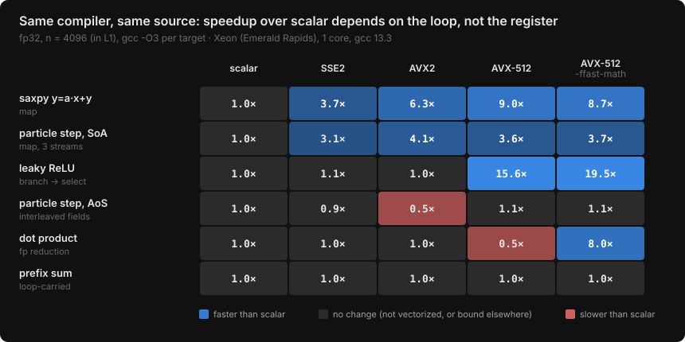

[← Back to Table of Contents](./README.md)

# Chapter 13 — Compiler Auto-Vectorization

> *"The vectorizer is the most conservative engineer on your team: it will only make a change it can prove is safe, and it writes down every reason it said no."*

## Overview

Between your loop and the SIMD instructions sits the compiler's vectorizer. GCC and LLVM each have
two: a **loop vectorizer**, which widens a loop's iterations into lanes, and an **SLP vectorizer**,
which packs independent straight-line operations into vectors. This chapter takes the loop vectorizer
apart step by step and reads its real remarks on this book's kernels at four target ISAs. It explains
each refusal in terms of Chapters 6–9, and ends with the levers you have when it refuses: flags,
pragmas, `restrict` and code shape.

<div class="manual">
<div class="manual-head"><b>LÖÖPVEKT</b><span>loop vectorizer · 6 steps · no user-serviceable parts inside</span></div>
<div class="manual-steps">
<div class="mstep"><div class="mstep-n">1</div><svg viewBox="0 0 200 90"><g stroke="#111" fill="none" stroke-width="1.5"><circle cx="40" cy="45" r="22"/><path d="M58 60 L78 78"/><rect x="110" y="25" width="70" height="40"/><path d="M118 45 H172"/></g><text x="145" y="18" font-size="9" text-anchor="middle">for (i…) {…}</text></svg><div class="mstep-cap"><b>Recognise</b> a countable innermost loop: one entry, one exit, a trip count computable on entry.</div></div>
<div class="mstep warn"><div class="mstep-n">2</div><svg viewBox="0 0 200 90"><g stroke="#111" fill="none" stroke-width="1.5"><circle cx="30" cy="45" r="6"/><circle cx="70" cy="45" r="6"/><circle cx="110" cy="45" r="6"/><circle cx="150" cy="45" r="6"/><path d="M36 40 Q50 22 64 40" stroke="#c00" stroke-width="2"/><path d="M76 40 Q90 22 104 40" stroke="#c00" stroke-width="2"/></g><text x="100" y="80" font-size="9" text-anchor="middle">dependences? aliasing? fp order?</text></svg><div class="mstep-cap"><b>Prove legality</b>: no dependence with 0 &lt; d &lt; V, reductions recognised, no unsafe calls (Chapter 6).</div></div>
<div class="mstep"><div class="mstep-n">3</div><svg viewBox="0 0 200 90"><g stroke="#111" fill="none" stroke-width="1.5"><rect x="20" y="30" width="30" height="30"/><rect x="60" y="30" width="45" height="30"/><rect x="115" y="30" width="65" height="30"/></g><text x="35" y="75" font-size="9" text-anchor="middle">VF 4</text><text x="82" y="75" font-size="9" text-anchor="middle">VF 8</text><text x="147" y="75" font-size="9" text-anchor="middle">VF 16 ✓</text></svg><div class="mstep-cap"><b>Cost model</b>: estimate cycles per element for each vector factor (VF) and interleave count; keep the cheapest, or keep scalar.</div></div>
<div class="mstep"><div class="mstep-n">4</div><svg viewBox="0 0 200 90"><g stroke="#111" fill="none" stroke-width="1.5"><path d="M20 45 H60"/><path d="M60 45 L90 25 H180"/><path d="M60 45 L90 65 H180"/></g><text x="135" y="20" font-size="9" text-anchor="middle">no overlap → vector</text><text x="135" y="80" font-size="9" text-anchor="middle">overlap → scalar</text></svg><div class="mstep-cap"><b>Version</b> the loop when legality depends on run-time facts: emit an overlap check and keep both copies.</div></div>
<div class="mstep"><div class="mstep-n">5</div><svg viewBox="0 0 200 90"><g stroke="#111" fill="none" stroke-width="1.5"><rect x="10" y="30" width="40" height="28"/><rect x="52" y="30" width="40" height="28"/><rect x="94" y="30" width="40" height="28"/><rect x="136" y="30" width="12" height="28" stroke-dasharray="3 2"/><rect x="150" y="30" width="12" height="28" stroke-dasharray="3 2"/></g><text x="100" y="78" font-size="9" text-anchor="middle">widen body · keep a tail</text></svg><div class="mstep-cap"><b>Widen</b>: replace each instruction by its vector form, add a scalar or masked epilogue for n mod VF.</div></div>
<div class="mstep"><div class="mstep-n">6</div><svg viewBox="0 0 200 90"><g stroke="#111" fill="none" stroke-width="1.5"><rect x="20" y="15" width="160" height="14"/><rect x="20" y="33" width="160" height="14"/><rect x="20" y="51" width="160" height="14"/><rect x="20" y="69" width="160" height="14"/></g><text x="100" y="26" font-size="9" text-anchor="middle">acc0</text><text x="100" y="44" font-size="9" text-anchor="middle">acc1</text><text x="100" y="62" font-size="9" text-anchor="middle">acc2</text><text x="100" y="80" font-size="9" text-anchor="middle">acc3</text></svg><div class="mstep-cap"><b>Interleave</b> (unroll) the vector body to hide latency: clang's "interleaved count: 4" is four accumulators.</div></div>
</div>
</div>

---

## Two vectorizers

| | Loop vectorizer | SLP vectorizer |
|---|---|---|
| **Looks for** | iterations of an innermost loop that can run side by side | isomorphic independent statements in straight-line code (`a[0]=…; a[1]=…; a[2]=…; a[3]=…`) |
| **Produces** | a vector loop + epilogue + optional runtime checks | packed vector instructions in place of scalar groups |
| **Origin** | vector-machine compilers, Allen & Kennedy | Larsen & Amarasinghe, PLDI 2000 ("superword level parallelism") |
| **In LLVM / GCC** | `LoopVectorize.cpp` / `tree-vect-loop.cc` | `SLPVectorizer.cpp` / `tree-vect-slp.cc` |
| **Catches** | maps, reductions, simple strided and conditional loops | unrolled code, small structs, complex-number arithmetic, our 12 scalar accumulators |

The SLP vectorizer is why the "scalar" peak kernel in Chapter 9 had to opt out of it: gcc packed its
12 independent scalar accumulators into vectors on its own. For an ordinary loop, the loop vectorizer
does the work and SLP mops up.

---

## Reading the remarks

Both compilers will tell you, per loop, what they did and why. The flags:

| Compiler | Successes | Failures | Reasons |
|---|---|---|---|
| **clang / LLVM** | `-Rpass=loop-vectorize` | `-Rpass-missed=loop-vectorize` | `-Rpass-analysis=loop-vectorize` |
| **gcc** | `-fopt-info-vec-optimized` | `-fopt-info-vec-missed` | `-fopt-info-vec-all` (verbose) |
| **Intel icx** | `-qopt-report=3` | (same report) | (same report) |
| **Compiler Explorer** | the "Opt Remarks" pane highlights each source line | | |

Here is what they said about this book's kernels (`tools/measurements/remarks.txt`, gcc 13.3 and clang 18.1):

<div class="crt">
<div class="crt-bar">tty4 — gcc -O3 -fopt-info-vec-optimized -fopt-info-vec-missed bench.c  (three targets)</div>
<div class="crt-screen"><pre>
<span class="dim">## -march=x86-64 (SSE2, 128-bit)</span>
bench.c:36:22: optimized: loop vectorized using 16 byte vectors        <span class="dim">saxpy</span>
bench.c:41:22: <span class="bad">missed: couldn't vectorize loop</span>                       <span class="dim">leaky ReLU</span>
bench.c:58:22: optimized: loop vectorized using 16 byte vectors        <span class="dim">dot (in-order!)</span>
bench.c:65:22: <span class="bad">missed: couldn't vectorize loop</span>                       <span class="dim">prefix sum</span>
bench.c:66:9:  <span class="warn">missed: not vectorized: unsupported use in stmt.</span>
<span class="dim">## -march=x86-64-v3 (AVX2, 256-bit)</span>
bench.c:41:22: <span class="bad">missed: couldn't vectorize loop</span>                       <span class="dim">still no</span>
bench.c:100:26: optimized: loop vectorized using 16 byte vectors       <span class="dim">mm_ijk inner k loop</span>
bench.c:100:59: <span class="warn">missed: not vectorized: not suitable for strided load</span>
<span class="dim">## -march=x86-64-v4 -mprefer-vector-width=512 (AVX-512)</span>
bench.c:41:22: optimized: loop vectorized using 64 byte vectors        <span class="dim">masks fix it</span>
bench.c:111:26: optimized: loop vectorized using 64 byte vectors       <span class="dim">mm_ikj inner j loop</span>
bench.c:111:49: <span class="warn">missed: not vectorized: complicated access pattern.</span>  <span class="dim">outer-loop attempt</span>
</pre></div>
</div>

<div class="crt">
<div class="crt-bar">tty5 — clang -O3 -march=x86-64-v4 -Rpass*=loop-vectorize bench.c</div>
<div class="crt-screen"><pre>
bench.c:36:3:  remark: vectorized loop (vectorization width: 8, interleaved count: 4)
bench.c:41:3:  remark: vectorized loop (vectorization width: 8, interleaved count: 4)
bench.c:58:34: <span class="bad">remark: loop not vectorized: cannot prove it is safe to reorder
               floating-point operations</span>
bench.c:65:3:  <span class="bad">remark: loop not vectorized: value that could not be identified as
               reduction is used outside the loop</span>
bench.c:76:3:  <span class="warn">remark: the cost-model indicates that interleaving is not beneficial</span>
bench.c:125:13: <span class="bad">remark: loop not vectorized: cannot prove it is safe to reorder
               floating-point operations</span>                         <span class="dim">pdist_naive</span>
bench.c:141:7: remark: vectorized loop (vectorization width: 8, interleaved count: 4) <span class="dim">pdist_outer</span>
</pre></div>
</div>

Four things to notice:

1. **The two compilers disagree.** clang vectorized leaky ReLU for an x86-64-v4 target at 256 bits
   ("width: 8"); gcc refused at 256 bits and accepted at 512 bits with masks. Their models of what
   speculation is safe differ (Chapter 8).
2. **clang chose 256-bit vectors on an AVX-512 target.** Several compilers default to
   `-mprefer-vector-width=256` on x86 because of the historical frequency penalty (Chapter 9). You must ask
   for 512 explicitly.
3. **"Vectorized" is not "fast".** gcc vectorized the strict-IEEE `dot` at every width by keeping the
   additions in order, and it got slower (below). It also vectorized a version of `mm_ijk`'s inner loop
   at 16 bytes, which bought nothing: 2.10 versus 2.08 GFLOP/s.
4. **"interleaved count: 4"** means four independent copies of the vector body, which is the
   multiple-accumulator technique applied automatically. VF × IC = 32 elements per iteration.

---

## Remark → cause → fix

| Remark (gcc / clang wording) | Cause | Chapter | Fix |
|---|---|:---:|---|
| "cannot prove it is safe to reorder floating-point operations" | FP reduction, no permission | 6 | `#pragma omp simd reduction(+:s)`, `-fassociative-math`, or partial sums by hand |
| "value that could not be identified as reduction is used outside the loop", "unsupported use in stmt" | a recurrence (scan) | 6, 10 | parallel scan, or accept scalar |
| "cannot identify array bounds" / "runtime pointer checks needed" / "possible aliasing" | aliasing | 6 | `restrict`, fewer pointers, or accept versioning |
| "control flow in loop" | a branch the vectorizer will not if-convert (speculation unsafe) | 8 | masks (AVX-512/SVE target), `-fno-trapping-math`, compute both sides explicitly |
| "statement clobbers memory" on a math call | `errno` side effect | 6 | `-fno-math-errno`, vector math library |
| "call instruction cannot be vectorized" | an opaque function call | 6 | inline it, `#pragma omp declare simd`, `-fveclib=libmvec` |
| "not suitable for strided load", "complicated access pattern" | non-unit stride or 2-D indexing | 7 | interchange loops, change layout, transpose |
| "loop control flow is not understood" | `break`, `goto`, unknown trip count | 8 | restructure as a counted loop; compute the trip count first |
| "the cost-model indicates that vectorization is not beneficial" | the cost model expects no gain | 9 | check the roofline; maybe it is right; otherwise `#pragma clang loop vectorize(enable)` |

---

## What it achieved: one heatmap

The speedup over scalar for six kernels at five compile targets, measured with data in L1:

<div class="fig"></div>

Each red or grey cell traces to a remark above. The AVX-512 strict `dot` is the clearest lesson in the
book about trusting "loop vectorized". Here is the inner loop gcc produced (from `remarks.txt`):

<div class="annot">
<pre><code>vmovups   (%r8,%rax), %zmm5           <span class="pin">1</span>
vmulps    (%rdx,%rax), %zmm5, %zmm1   <span class="pin">1</span>
vshufps   $85, %xmm1, %xmm1, %xmm4    <span class="pin">2</span>
vaddss    %xmm1, %xmm0, %xmm0         <span class="pin">3</span>
vaddss    %xmm4, %xmm0, %xmm0         <span class="pin">3</span>
vunpckhps %xmm1, %xmm1, %xmm4
vaddss    %xmm4, %xmm0, %xmm0         <span class="pin">3</span>
...        (16 vaddss in total)
vextractf32x8 $0x1, %zmm1, %ymm1      <span class="pin">2</span>
...
jne       .L115                        <span class="pin">4</span></code></pre>
<ol class="annot-notes">
<li><span class="pin">1</span><b>The vector part.</b> 16 products in one load and one multiply: this is what "vectorized using 64 byte vectors" refers to.</li>
<li><span class="pin">2</span><b>Lane extraction.</b> Shuffles, unpacks, aligns and extracts pull each of the 16 products into lane 0 of a register.</li>
<li><span class="pin">3</span><b>The serial chain.</b> Sixteen scalar <code>vaddss</code>, each depending on the previous one through <code>%xmm0</code>: the original left-to-right order, preserved exactly as IEEE semantics demand.</li>
<li><span class="pin">4</span><b>The result.</b> 16 × 4-cycle dependent adds per 16 elements, plus shuffle-port pressure: 1.12 ns per element versus 0.60 for the plain scalar loop.</li>
</ol>
</div>

---

## Levers when the vectorizer says no

| Lever | Scope | Example | Risk |
|---|---|---|---|
| **Target flags** | whole build | `-march=native`, `-march=x86-64-v3`, `-mprefer-vector-width=512` | binary will not run on older CPUs |
| **Function multi-versioning** | one function | `__attribute__((target_clones("avx512f","avx2","default")))` | code size |
| **`restrict`** | function arguments | `float *restrict y` | wrong results if callers alias |
| **OpenMP SIMD** | one loop | `#pragma omp simd reduction(+:s) simdlen(16)` with `-fopenmp-simd` | you assert legality |
| **Compiler pragmas** | one loop | `#pragma clang loop vectorize(enable) interleave_count(4)`, `#pragma GCC ivdep` | you assert legality |
| **Narrow FP flags** | translation unit | `-fno-math-errno`, `-fno-trapping-math`, `-fassociative-math` | changes FP semantics in that file |
| **`-ffast-math`** | translation unit | all of the above and more | NaN/Inf assumptions can break correct code |
| **Alignment hints** | pointers | `__builtin_assume_aligned(p, 64)` | undefined behaviour if false |
| **Code shape** | source | counted `for` loops, local accumulators, SoA, no calls in the body, signed `int` or `size_t` indices | none: this is the durable fix |

<div class="callout field"><span class="callout-title">Field note</span>
<p>Pragmas and flags make a loop vectorize <em>today</em>, with this compiler. Code shape makes it vectorize
with every compiler and survives refactoring. Prefer shape. Use pragmas to state a fact the compiler cannot
prove (no aliasing, a reduction is OK to reorder), and leave a comment saying why it is true. Then add a
test or CI check that fails if the remark disappears, because vectorization regressions are silent.</p>
</div>

---

## Code shapes vectorizers like

```c
// 1. Counted loop, local accumulator, restrict, no calls: vectorizes everywhere.
float dot(const float *restrict x, const float *restrict y, int n) {
    float s = 0.0f;
    #pragma omp simd reduction(+:s)
    for (int i = 0; i < n; i++) s += x[i] * y[i];
    return s;
}

// 2. Hoist invariants and conditions out of the loop body (loop unswitching by hand).
if (alpha == 1.0f) for (int i = 0; i < n; i++) y[i] += x[i];
else               for (int i = 0; i < n; i++) y[i] += alpha * x[i];

// 3. Write through a local pointer, not through a struct member the compiler must reload.
float *restrict out = obj->buf;          // otherwise obj->buf may alias the inputs
for (int i = 0; i < n; i++) out[i] = f(in[i]);
```

<div class="callout ponder"><span class="callout-title">Ponder</span>
<p>Your build probably compiles with <code>-O2</code> and no <code>-march</code>, so every loop targets SSE2.
How many of your hot loops would change if you compiled with <code>-march=x86-64-v3</code>? Your NumPy and
PyTorch already contain multiple versions and pick one at run time; does your own C++ extension?</p>
</div>

---

## Beyond C: vectorizers in ML compilers

The same steps (recognise, prove, cost, version, widen, interleave) appear in every ML compiler, at a
different level:

| Compiler | Where vectorization happens | What you control |
|---|---|---|
| **XLA (CPU)** | emits LLVM IR for fused loops; LLVM's loop vectorizer widens them | fusion decisions via flags |
| **TorchInductor (CPU)** | emits C++ using `at::vec::Vectorized<T>` directly (explicit SIMD) plus a scalar tail | `torch.compile` options; read `output_code` |
| **TorchInductor / Triton (GPU)** | block-level programs; Triton lowers to vectorized loads and tensor-core MMAs | block sizes, `num_warps` ([Chapter 15](./15_gpus_simt.md)) |
| **MLIR** | the `vector` dialect: target-independent vector ops lowered to LLVM, SPIR-V or GPU | used by IREE, Triton, Mojo internals |
| **TVM / Halide** | a separate *schedule* says `vectorize(x, 16)`; legality is the user's responsibility | the schedule |

Halide's split between *algorithm* (what to compute) and *schedule* (how: tile, vectorize, parallelise)
is the cleanest statement of this book's six questions: the algorithm answers question 1, and the schedule
answers questions 3–6.

---

## Key Takeaways

- Compilers have a loop vectorizer (iterations → lanes) and an SLP vectorizer (independent statements → lanes); both work in six steps: recognise, prove, cost, version, widen, interleave.
- Every refusal has a printed reason; read `-Rpass*` (clang) or `-fopt-info-vec*` (gcc) before rewriting anything.
- gcc and clang disagreed on leaky ReLU at 256 bits, and clang defaulted to 256-bit vectors on an AVX-512 target: the target and the compiler both change the answer.
- "Loop vectorized" can be slower than scalar: gcc's strict-IEEE `dot` kept 16 serial adds per iteration (1.12 vs 0.60 ns/element).
- Prefer code shape (counted loops, local accumulators, `restrict`, no calls, SoA) over pragmas and flags; guard important loops against silent regressions.
- ML compilers (XLA, Inductor, Triton, MLIR, Halide/TVM) repeat the same steps, often generating explicit SIMD instead of relying on LLVM.

## Check Yourself

<details class="check"><summary>clang reports "vectorization width: 8, interleaved count: 4" for a float loop on an AVX-512 machine. How many elements per iteration, and why not 16-wide?</summary>
8 × 4 = 32 elements per iteration, in four 256-bit vectors. The default preferred vector width on that target is 256 bits; pass <code>-mprefer-vector-width=512</code> to allow 16-wide vectors.
</details>

<details class="check"><summary>gcc says "control flow in loop" for <code>y[i] = x[i] &gt; 0 ? sqrtf(x[i]) : 0</code>. Name two independent reasons it might refuse.</summary>
Speculating <code>sqrtf</code> on lanes where x ≤ 0 could raise an invalid-operation flag (trapping math), and <code>sqrtf</code> may set <code>errno</code> (math-errno). <code>-fno-trapping-math -fno-math-errno</code> or an AVX-512/SVE target with masked execution address them.
</details>

<details class="check"><summary>Why is "add a CI check on the remark" a good idea for a performance-critical loop?</summary>
Vectorization depends on fragile facts: a new pointer argument, a function call, a changed type or a compiler upgrade can silently turn the loop scalar, with no test failure and a several-fold slowdown. Grepping the remark output (or benchmarking) catches it.
</details>

## References

| Source | Authors / Org, Year | Link | What this chapter takes from it |
|--------|--------------------|------|--------------------------------|
| Auto-Vectorization in LLVM | LLVM Project | llvm.org/docs/Vectorizers.html | Loop and SLP vectorizers, remarks, pragmas, cost model |
| Auto-vectorization in GCC | GCC Project | gcc.gnu.org/projects/tree-ssa/vectorization.html | GCC's vectorizer and `-fopt-info` |
| Exploiting Superword Level Parallelism with Multimedia Instruction Sets | Larsen & Amarasinghe, PLDI 2000 | doi:10.1145/349299.349320 | SLP vectorization |
| Optimizing Compilers for Modern Architectures | Allen & Kennedy, 2001 | Morgan Kaufmann | Loop vectorization theory |
| OpenMP 5.2 specification — SIMD directives | OpenMP ARB, 2021 | openmp.org | `omp simd`, `reduction`, `declare simd` |
| Halide: A Language and Compiler for Optimizing Parallelism, Locality, and Recomputation | Ragan-Kelley et al., PLDI 2013 | doi:10.1145/2491956.2462176 | Algorithm/schedule separation |
| MLIR `vector` dialect documentation | LLVM / MLIR | mlir.llvm.org/docs/Dialects/Vector | Target-independent vector IR |
| This book's measurements | `tools/measurements/remarks.txt`, `results.json` | [repo](https://github.com/karam-nus/vectorization/tree/main/tools/measurements) | Remarks, heatmap, dot assembly |

---

**Next:** [Chapter 14 — Explicit SIMD: Intrinsics, Libraries & SPMD](./14_explicit_simd.md) — when you take the wheel from the compiler.
