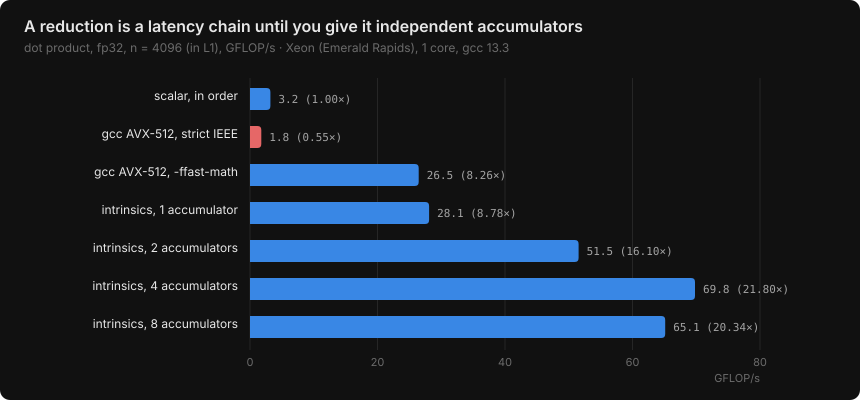

[← Back to Table of Contents](./README.md)

# Chapter 14 — Explicit SIMD: Intrinsics, Libraries & SPMD

> *"Intrinsics are assembly with type checking. Use them where the compiler cannot see what you know, and nowhere else."*

## Overview

When the vectorizer refuses, or vectorizes badly, you can write the vector code yourself. There are
three levels. **Intrinsics** are one C function per instruction. **Portable SIMD libraries** wrap
intrinsics in a vector type that compiles to any ISA. **SPMD languages** let you write scalar-looking
code that the compiler maps onto lanes, as CUDA does on GPUs. This chapter reads one real intrinsics
kernel line by line and measures the payoff of the choices it makes. It shows the same loop in
vector-length-agnostic form for Arm SVE and RISC-V V, and compares the three levels on what they cost
you to maintain.

<div class="annot">
<pre><code>float dot_4acc(long n, const float *x, const float *y) {
  __m512 acc[4] = {0};                                 <span class="pin">1</span>
  long i = 0;
  for (; i + 64 &lt;= n; i += 64)                         <span class="pin">2</span>
    for (int k = 0; k &lt; 4; k++)
      acc[k] = _mm512_fmadd_ps(                        <span class="pin">3</span>
          _mm512_loadu_ps(x + i + 16*k),
          _mm512_loadu_ps(y + i + 16*k), acc[k]);
  for (; i + 16 &lt;= n; i += 16)
    acc[0] = _mm512_fmadd_ps(_mm512_loadu_ps(x + i),
                             _mm512_loadu_ps(y + i), acc[0]);
  __mmask16 t = (1u &lt;&lt; (n - i)) - 1u;                  <span class="pin">4</span>
  acc[0] = _mm512_fmadd_ps(_mm512_maskz_loadu_ps(t, x + i),
                           _mm512_maskz_loadu_ps(t, y + i), acc[0]);
  acc[0] = _mm512_add_ps(_mm512_add_ps(acc[0], acc[1]),
                         _mm512_add_ps(acc[2], acc[3]));
  return _mm512_reduce_add_ps(acc[0]);                 <span class="pin">5</span>
}</code></pre>
<ol class="annot-notes">
<li><span class="pin">1</span><b>Four accumulators</b> = four independent dependency chains. One chain ran at 28.1 GFLOP/s; four at 69.8 (measured, n = 4096 in L1).</li>
<li><span class="pin">2</span><b>Strip-mining by hand</b>: 64 floats per iteration (4 × 16 lanes).</li>
<li><span class="pin">3</span><b>Naming</b>: <code>_mm512</code> = 512-bit, <code>fmadd</code> = fused multiply-add, <code>_ps</code> = packed single (fp32). <code>loadu</code> = unaligned load.</li>
<li><span class="pin">4</span><b>Masked tail</b>: a bitmask with one bit per remaining lane; the masked load zero-fills the rest and cannot fault past the end.</li>
<li><span class="pin">5</span><b>One horizontal reduction</b>, after the loop, never inside it (Chapter 3). The summation order is now yours to document.</li>
</ol>
</div>

---

## The intrinsic naming code

Intrinsic names look arbitrary until you see the pattern. Each family encodes width, operation and
element type:

| ISA | Pattern | Example | Reads as |
|---|---|---|---|
| **SSE / AVX / AVX-512** | `_mm{,256,512}_<op>_<type>` | `_mm512_mask_blend_ps` | 512-bit, masked blend, packed fp32 |
| | types: `ps` fp32, `pd` fp64, `ph` fp16, `epi8/16/32/64` signed ints, `epu8…` unsigned, `si512` whole register | `_mm256_cvtepi8_epi32` | 256-bit, convert int8 to int32 (widen) |
| **NEON** | `v<op>[q]_<type>` (`q` = 128-bit) | `vfmaq_f32` | fused multiply-add, 128-bit, fp32 |
| **SVE (ACLE)** | `sv<op>_<type>[_m/_z/_x]` (merge / zero / don't-care predication) | `svmla_n_f32_m` | multiply-add with a scalar, fp32, merge inactive lanes |
| **RISC-V V** | `__riscv_v<op>_<form>_<type><LMUL>` | `__riscv_vfmacc_vf_f32m8` | FMA, vector × scalar form, fp32, group of 8 registers |

The [Intel Intrinsics Guide](https://www.intel.com/content/www/us/en/docs/intrinsics-guide/index.html)
lists every x86 intrinsic with pseudocode and, for recent cores, latency and throughput. Arm's
ACLE documentation and the RISC-V intrinsics specification play the same role.

---

## What hand-written code bought, measured

All on one Xeon core (Emerald Rapids), fp32, n = 4096 in L1, ns per element:

| Kernel | Best compiler output | Hand-written AVX-512 | Why hand-written won (or did not) |
|---|:---:|:---:|---|
| **dot product** | 0.0756 (`-ffast-math`, 1 accumulator) · 1.13 (strict) | **0.0287** (4 acc.) | multiple accumulators; no flags needed because *you* chose the order |
| **leaky ReLU** | 0.0457 (`-ffast-math`) · 0.0571 (strict) | 0.0498 | essentially a tie: the compiler did the same compare-mask-blend |
| **strided read** (s = 4) | 0.738 | 0.772 (`vgatherdps`) | no win: memory-bound (Chapter 7) |

<div class="fig"></div>

The pattern is general. Explicit SIMD wins big when you know something the compiler may not
assume: that reassociation is fine, that a pointer is aligned, that a lookup table fits in a register,
or which instruction (VNNI, `vpermb`, `pshufb`) solves the problem in one step. It ties when the
compiler already had the right idea, and it loses nothing to memory-bound kernels only because nothing
can help those.

<div class="callout ponder"><span class="callout-title">Ponder</span>
<p>Four accumulators beat eight here (69.8 vs 65.1 GFLOP/s) even though Little's law asked for eight.
What resource ran out first? Count the loads per FMA, and the load ports per cycle. Then ask how the answer
changes for a GEMM microkernel, where one loaded value feeds many FMAs.</p>
</div>

---

## Vector-length agnostic: the same loop on SVE and RISC-V V

Fixed-width intrinsics hard-code $V$. SVE and RISC-V V do not. The loop asks the hardware how many
lanes it has (SVE `svcntw()`) or how many it may use this iteration (RISC-V `vsetvl`). Predicates
handle the tail. Sources in [`code/simd/`](https://github.com/karam-nus/vectorization/tree/main/code/simd),
cross-compiled with clang 18 and disassembled (`code/simd/check.sh`):

```c
// Arm SVE
for (int64_t i = 0; i < n; i += svcntw()) {          // fp32 lanes on THIS chip
    svbool_t pg = svwhilelt_b32_s64(i, n);           // lanes i..n-1 active
    svfloat32_t vx = svld1_f32(pg, x + i);
    svfloat32_t vy = svld1_f32(pg, y + i);
    svst1_f32(pg, y + i, svmla_n_f32_m(pg, vy, vx, a));
}
```

<div class="crt">
<div class="crt-bar">tty6 — llvm-objdump: SVE and RISC-V V saxpy, entire loop</div>
<div class="crt-screen"><pre>
<span class="dim">## Arm SVE  (clang --target=aarch64 -march=armv8-a+sve)</span>
10:  cntw    x9                               <span class="dim">lanes per vector, asked at run time</span>
14:  whilelt p0.s, x8, x0                     <span class="dim">predicate: i &lt; n, lane by lane</span>
18:  ld1w    { z1.s }, p0/z, [x1, x8, lsl #2]
1c:  ld1w    { z2.s }, p0/z, [x2, x8, lsl #2]
20:  fmla    z2.s, p0/m, z1.s, z0.s
24:  st1w    { z2.s }, p0, [x2, x8, lsl #2]
28:  add     x8, x8, x9
2c:  cmp     x8, x0
30:  b.lt    0x14                             <span class="warn">no epilogue: the tail is the last predicate</span>

<span class="dim">## RISC-V V 1.0  (clang --target=riscv64 -march=rv64gcv)</span>
2:   vsetvli   a3, a0, e32, m8, ta, ma        <span class="dim">vl = min(n, VLMAX): how many this time</span>
6:   vle32.v   v8, (a1)
a:   vle32.v   v16, (a2)
e:   vfmacc.vf v16, fa0, v8
12:  vse32.v   v16, (a2)
1c:  sub       a0, a0, a3                     <span class="warn">the last trip simply gets a smaller vl</span>
</pre></div>
</div>

The SVE loop is eight instructions with no tail code and runs unchanged on 128-bit (Neoverse V2),
256-bit (Neoverse V1) and 512-bit (A64FX) implementations. The NEON version in the same folder needs
a separate scalar tail loop, and an AVX-512 build would not run at all on an AVX2-only CPU. The cost of
vector-length agnosticism appears elsewhere: $V$ is unknown at compile time, so tile sizes, unrolling
and shuffle patterns that depend on the exact width are harder to express ([Chapter 17](./17_architects_view.md)).

---

## Portable SIMD libraries

Between the compiler and raw intrinsics sit libraries that give you a **vector type** with operators
and compile it to whatever the target supports:

| Library | Language | Width model | Notes |
|---|---|---|---|
| **Highway** (Google) | C++ | fixed or scalable (supports SVE/RVV) | runtime dispatch built in; used in Chromium, JPEG XL, NumPy's sort |
| **xsimd** | C++ | fixed per target | used by xtensor, Apache Arrow |
| **`std::simd`** | C++26 | `native_simd<T>` per target | standardised from the Parallelism TS (P1928) |
| **Rust `std::simd`** | Rust | `Simd<T, N>` | nightly `portable_simd` |
| **SIMDe** | C | emulates one ISA's intrinsics on another | ports x86 intrinsics code to Arm |
| **Eigen packets** | C++ | internal | the SIMD layer under Eigen and TensorFlow's CPU kernels |
| **`at::vec::Vectorized<T>`** | C++ | per-target specialisations | what TorchInductor's CPU code generator emits (Chapter 12) |
| **NumPy universal intrinsics** (NPYV) | C | per-target, dispatched | NumPy's own SIMD kernels |
| **Mojo `SIMD[dtype, width]`** | Mojo | width as a type parameter | SIMD as a first-class type in a Python-like language |
| **Java Vector API**, **.NET `Vector<T>`** | Java, C# | species / platform width | managed-runtime SIMD |

<div class="versus">
<div class="fighter p1"><div class="f-name">INTRINSICS</div><div class="f-title">one function per instruction</div>
<div class="f-stat"><span>Peak speed</span><span class="f-bar" style="--v:.95"></span></div>
<div class="f-stat"><span>Portability</span><span class="f-bar" style="--v:.1"></span></div>
<div class="f-stat"><span>Readability</span><span class="f-bar" style="--v:.2"></span></div>
<div class="f-stat"><span>Access to odd ops</span><span class="f-bar" style="--v:1"></span></div>
<div class="f-stat"><span>Maintenance</span><span class="f-bar" style="--v:.15"></span></div>
<div class="f-quote">"Every instruction, exactly where I want it."</div></div>
<div class="vs">VS</div>
<div class="fighter p2"><div class="f-name">PORTABLE SIMD</div><div class="f-title">a vector type with operators</div>
<div class="f-stat"><span>Peak speed</span><span class="f-bar" style="--v:.85"></span></div>
<div class="f-stat"><span>Portability</span><span class="f-bar" style="--v:.9"></span></div>
<div class="f-stat"><span>Readability</span><span class="f-bar" style="--v:.7"></span></div>
<div class="f-stat"><span>Access to odd ops</span><span class="f-bar" style="--v:.5"></span></div>
<div class="f-stat"><span>Maintenance</span><span class="f-bar" style="--v:.75"></span></div>
<div class="f-quote">"One source, every ISA, dispatched at run time."</div></div>
</div>
<div class="genre-caption">Stats are this book's judgement, not measurements. The usual winning strategy is a portable library for 95 % of a kernel and an escape hatch to intrinsics for the one instruction the library does not expose.</div>

---

## SPMD on SIMD: ISPC and friends

CUDA's programming model, scalar code per thread with the hardware forming warps, works on CPU SIMD too.
**ISPC** (Intel SPMD Program Compiler; Pharr & Mark, 2012) compiles code like this:

```c
export void leaky(uniform float x[], uniform float y[], uniform int n) {
    foreach (i = 0 ... n) {               // program instances -> SIMD lanes
        float v = x[i];                   // "varying": one value per lane
        y[i] = v > 0 ? v : 0.01f * v;     // if/else -> masks, generated for you
    }
}
```

`uniform` values are shared by all lanes, which would otherwise be broadcast registers, while
`varying` values are one per lane. Control flow becomes masks automatically. The model makes
divergence, gathers and scatters visible in the type system: a `varying` index into an array is a
gather, and ISPC warns about it. OpenMP's `#pragma omp simd` and `declare simd` are a lighter-weight
version of the same idea in C and C++.

---

## Runtime dispatch

A binary built with `-march=x86-64-v4` crashes on a CPU without AVX-512. Libraries therefore build
several versions and choose at run time:

```c
// GCC / clang: one source, three compiled versions, chosen at load time via CPUID
__attribute__((target_clones("avx512f", "avx2", "default")))
void saxpy(int n, float a, const float *x, float *y) {
    for (int i = 0; i < n; i++) y[i] = a * x[i] + y[i];
}
```

You can see the mechanism in production libraries: `numpy.show_runtime()` lists which SIMD extensions
NumPy found and which of its kernels use them, and `torch.backends.cpu.get_cpu_capability()` reports
the level PyTorch dispatched to.

---

## Pitfalls that only explicit SIMD has

| Pitfall | Symptom | Fix |
|---|---|---|
| **AVX↔SSE transition penalty** | mysterious slowdown after calling legacy SSE code | `_mm256_zeroupper()` / compile everything with VEX encoding |
| **Denormals** | 10–100× slowdown on tiny values | set flush-to-zero / denormals-are-zero (`_MM_SET_FLUSH_ZERO_MODE`) when acceptable |
| **Unchecked tails** | reads past the end; crashes only at page boundaries | masked loads, or a scalar epilogue |
| **Hidden summation order** | results differ from the reference | document the order; test with tolerance (Chapter 6) |
| **Untested dispatch paths** | the AVX2 fallback is broken and nobody's CI has AVX2 only | run the test suite once per dispatch level (most libraries can force a level by environment variable) |
| **Over-unrolling** | register spills to the stack | count live vector registers: 16 `ymm` or 32 `zmm` |

<div class="callout field"><span class="callout-title">Field note</span>
<p>Keep a scalar reference implementation next to every intrinsics kernel, and test the two against each
other on random lengths from 0 to a few hundred. Most SIMD bugs live in the tail or in a lane permutation.
Both are caught by lengths like 1, 15, 16, 17 and 33, and both are invisible at lengths that are
multiples of 64.</p>
</div>

---

## Key Takeaways

- Explicit SIMD comes in three levels: intrinsics, portable vector types and SPMD languages; choose the highest one that exposes the instructions you need.
- Hand-written code wins when you encode knowledge the compiler may not assume: four accumulators gave 0.0287 ns/element versus 0.0756 for the best compiler output, with no `-ffast-math`.
- It ties when the compiler already found the idea (leaky ReLU) and cannot beat a memory-bound loop (gather).
- Vector-length-agnostic code (SVE, RISC-V V) has no tail code and runs at any width; the price is a width unknown at compile time.
- Shipping explicit SIMD means shipping dispatch: several builds chosen at run time, each needing its own tests.
- Keep a scalar reference and test lengths around multiples of V; that is where SIMD bugs live.

## Check Yourself

<details class="check"><summary>Decode <code>_mm256_maskz_cvtepi8_epi32</code>.</summary>
A 256-bit result; zero-masking (inactive lanes set to 0); convert packed signed int8 to signed int32 (sign-extending widen) — 8 int8 inputs become 8 int32 lanes.
</details>

<details class="check"><summary>Why does the SVE saxpy loop need no epilogue while the NEON one does?</summary>
SVE builds a predicate per iteration with <code>whilelt</code>, so the final iteration simply has fewer active lanes and its masked loads and stores never touch memory beyond n. NEON has no predicated loads or stores, so the remaining n mod 4 elements need scalar code (or padding).
</details>

<details class="check"><summary>When would you choose ISPC over intrinsics for a CPU kernel?</summary>
When the kernel has non-trivial per-element control flow and you want the compiler to generate masks and blends for you while keeping explicit control over which data is per-lane (varying) versus shared (uniform) — e.g. ray tracing, simulation, image processing — and you can accept a separate compiler in the build.
</details>

## References

| Source | Authors / Org, Year | Link | What this chapter takes from it |
|--------|--------------------|------|--------------------------------|
| Intel Intrinsics Guide | Intel | intel.com/content/www/us/en/docs/intrinsics-guide | Names, semantics, latencies |
| Arm C Language Extensions (ACLE) for SVE | Arm | developer.arm.com | `svwhilelt`, predicated loads, `_m/_z/_x` forms |
| RISC-V Vector C intrinsics specification | RISC-V International | github.com/riscv-non-isa/rvv-intrinsic-doc | `__riscv_vsetvl`, LMUL types |
| ispc: A SPMD Compiler for High-Performance CPU Programming | Pharr & Mark, InPar 2012 | doi:10.1109/InPar.2012.6339601 | SPMD on SIMD, uniform/varying |
| Highway — performance-portable SIMD | Google | github.com/google/highway | Portable and scalable vectors, dynamic dispatch |
| std::simd — merge data-parallel types from the Parallelism TS 2 (P1928) | Kretz, WG21 2023–2025 | open-std.org | Standard C++ SIMD types |
| GCC function multi-versioning (`target_clones`) | GNU | gcc.gnu.org/onlinedocs | Runtime dispatch |
| This book's code and measurements | `code/bench/bench.c`, `code/simd/`, `results.json`, `simd_asm.txt` | [repo](https://github.com/karam-nus/vectorization) | Intrinsics kernels, accumulator sweep, SVE/RVV/NEON listings |

---

**Next:** [Chapter 15 — GPUs: SIMT, Warps & Tiles](./15_gpus_simt.md) — the vector unit that pretends to be thousands of threads.
