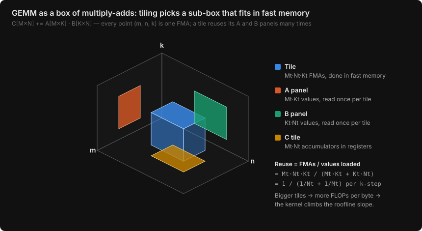

[← Back to Table of Contents](./README.md)

# Chapter 16 — Matrix Engines: Systolic Arrays, Tensor Cores, AMX & SME

> *"A vector instruction reuses each operand once. A matrix instruction reuses it N times. That one factor is why every AI chip looks the way it does."*

## Overview

The answer to Chapter 0's question, what is the cheapest machine for a workload that is only matrix
multiplication, is a grid of multiply-accumulate units fed from two edges, with no instruction per
multiply at all. This chapter derives why: the **operand reuse** of an instruction grows linearly with
its tile size. It then draws the systolic array that exploits this and walks through four commercial
designs (TPU MXU, Tensor Cores, Intel AMX, Arm SME). It also measures AMX on this book's Xeon:
**2.41 TFLOP/s of bf16 on one core**, 13× the core's AVX-512 fp32 roof. The lab lets you clock a
systolic array by hand.

<svg viewBox="0 0 760 400" width="760" role="img" aria-label="Blueprint of a 4 by 4 output-stationary systolic array with skewed A inputs from the left and B inputs from the top">
<defs><marker id="bpa" markerWidth="7" markerHeight="7" refX="6" refY="3.5" orient="auto"><path d="M0,0 L7,3.5 L0,7 Z" fill="#e3f1ff"/></marker></defs>
<g fill="none" stroke="#e3f1ff" stroke-width="1.5">
<rect x="250" y="90" width="56" height="56"/><rect x="330" y="90" width="56" height="56"/><rect x="410" y="90" width="56" height="56"/><rect x="490" y="90" width="56" height="56"/>
<rect x="250" y="170" width="56" height="56"/><rect x="330" y="170" width="56" height="56"/><rect x="410" y="170" width="56" height="56"/><rect x="490" y="170" width="56" height="56"/>
<rect x="250" y="250" width="56" height="56"/><rect x="330" y="250" width="56" height="56"/><rect x="410" y="250" width="56" height="56"/><rect x="490" y="250" width="56" height="56"/>
<rect x="250" y="330" width="56" height="56" stroke-dasharray="4 3"/><rect x="330" y="330" width="56" height="56" stroke-dasharray="4 3"/><rect x="410" y="330" width="56" height="56" stroke-dasharray="4 3"/><rect x="490" y="330" width="56" height="56" stroke-dasharray="4 3"/>
</g>
<g stroke="#e3f1ff" stroke-width="1.2" marker-end="url(#bpa)">
<line x1="306" y1="118" x2="328" y2="118"/><line x1="386" y1="118" x2="408" y2="118"/><line x1="466" y1="118" x2="488" y2="118"/>
<line x1="306" y1="198" x2="328" y2="198"/><line x1="386" y1="198" x2="408" y2="198"/><line x1="466" y1="198" x2="488" y2="198"/>
<line x1="306" y1="278" x2="328" y2="278"/><line x1="386" y1="278" x2="408" y2="278"/><line x1="466" y1="278" x2="488" y2="278"/>
<line x1="278" y1="146" x2="278" y2="168"/><line x1="358" y1="146" x2="358" y2="168"/><line x1="438" y1="146" x2="438" y2="168"/><line x1="518" y1="146" x2="518" y2="168"/>
<line x1="278" y1="226" x2="278" y2="248"/><line x1="358" y1="226" x2="358" y2="248"/><line x1="438" y1="226" x2="438" y2="248"/><line x1="518" y1="226" x2="518" y2="248"/>
<line x1="278" y1="306" x2="278" y2="328"/><line x1="358" y1="306" x2="358" y2="328"/><line x1="438" y1="306" x2="438" y2="328"/><line x1="518" y1="306" x2="518" y2="328"/>
<line x1="215" y1="118" x2="248" y2="118"/><line x1="215" y1="198" x2="248" y2="198"/><line x1="215" y1="278" x2="248" y2="278"/>
<line x1="278" y1="58" x2="278" y2="88"/><line x1="358" y1="58" x2="358" y2="88"/><line x1="438" y1="58" x2="438" y2="88"/><line x1="518" y1="58" x2="518" y2="88"/>
</g>
<g font-size="11" fill="#e3f1ff" text-anchor="middle">
<text x="278" y="114">× +</text><text x="358" y="114">× +</text><text x="438" y="114">× +</text><text x="518" y="114">× +</text>
<text x="278" y="194">× +</text><text x="358" y="194">× +</text><text x="438" y="194">× +</text><text x="518" y="194">× +</text>
<text x="278" y="274">× +</text><text x="358" y="274">× +</text><text x="438" y="274">× +</text><text x="518" y="274">× +</text>
<text x="278" y="134" fill="#8fc3f5" font-size="9">C00</text><text x="358" y="134" fill="#8fc3f5" font-size="9">C01</text><text x="438" y="134" fill="#8fc3f5" font-size="9">C02</text><text x="518" y="134" fill="#8fc3f5" font-size="9">C03</text>
<text x="278" y="214" fill="#8fc3f5" font-size="9">C10</text><text x="358" y="214" fill="#8fc3f5" font-size="9">C11</text><text x="438" y="214" fill="#8fc3f5" font-size="9">C12</text><text x="518" y="214" fill="#8fc3f5" font-size="9">C13</text>
<text x="278" y="294" fill="#8fc3f5" font-size="9">C20</text><text x="358" y="294" fill="#8fc3f5" font-size="9">C21</text><text x="438" y="294" fill="#8fc3f5" font-size="9">C22</text><text x="518" y="294" fill="#8fc3f5" font-size="9">C23</text>
</g>
<g font-size="10" fill="#e3f1ff" font-family="JetBrains Mono, monospace">
<text x="40" y="122">A row 0 →  a03 a02 a01 a00</text>
<text x="40" y="202">A row 1 →  a13 a12 a11 a10 ·</text>
<text x="40" y="282">A row 2 →  a23 a22 a21 a20 · ·</text>
<text x="255" y="20">B col 0</text><text x="335" y="20">B col 1</text><text x="415" y="20">B col 2</text><text x="495" y="20">B col 3</text>
<text x="262" y="36" fill="#8fc3f5">b00↓</text><text x="342" y="36" fill="#8fc3f5">· b01↓</text><text x="422" y="36" fill="#8fc3f5">· · b02↓</text><text x="502" y="36" fill="#8fc3f5">· · · b03↓</text>
</g>
<g font-size="10" fill="#bcdcff"><text x="570" y="122">each PE per clock:</text><text x="570" y="138">c += a · b</text><text x="570" y="154">pass a → right</text><text x="570" y="170">pass b ↓ down</text><text x="570" y="200">no instruction fetch,</text><text x="570" y="216">no register file,</text><text x="570" y="232">neighbour wires only</text></g>
</svg>

NOTE: "·" marks one clock of skew. A[i,k] and B[k,j] meet in PE(i,j) at clock t = i + j + k. Row 3 (dashed) continues the pattern. Output-stationary: C stays put; A and B flow.

DWG NO.VZ-16TITLE4×4 SYSTOLIC ARRAY (OS)SCALENTSSHEET1 OF 1

---

## Why matrices: operand reuse per instruction

Every operand an instruction consumes has to be delivered by something: a register file read, a
shared-memory read, a wire from a neighbour. The useful work per delivered operand decides energy and
bandwidth per FLOP. Count multiply-accumulates (MACs) per input operand for each instruction shape:

| Instruction shape | Inputs delivered | MACs performed | MACs per input |
|---|:---:|:---:|:---:|
| **scalar FMA** | 2 | 1 | 0.5 |
| **vector FMA**, $V$ lanes (AVX-512 fp32: $V$ = 16) | $2V$ | $V$ | **0.5** |
| **outer product**, $V \times V$ (Arm SME `FMOPA`) | $2V$ | $V^2$ | $V/2$ = 8 at $V$ = 16 |
| **tile multiply** $M \times K$ by $K \times N$ (AMX `TDPBF16PS`: 16×32 · 32×16) | $MK + KN$ = 1024 | $MNK$ = 8192 | **8** |
| **tensor core** wgmma m64 n256 k16 | 64·16 + 16·256 = 5120 | 262 144 | **51** |
| **systolic array** $R \times C$, weight-stationary, $R = C = 256$ | each activation crosses $C$ PEs | | **256** |

For a square tile of side $N$:

$$\frac{\text{MACs}}{\text{inputs}} = \frac{N^3}{2N^2} = \frac{N}{2}$$

**Numerical check.** $N = 16$: $16^3 = 4096$ MACs from $2 \cdot 256 = 512$ inputs, 8 per input. A
vector FMA does 0.5 regardless of width. Making vectors wider buys more lanes, not more reuse; making
the instruction a matrix buys reuse. This is the arithmetic-intensity argument of Chapter 9 moved inside
one instruction, and it is the tile box of Chapter 4 at the scale of hardware.

---

## Systolic arrays

H. T. Kung's 1982 paper *Why Systolic Architectures?* gave the design its name: data pulses through a
grid of simple processing elements (PEs) like blood through the heart. Each PE does one multiply-add
per clock on values arriving from its neighbours and passes them on. There is no instruction per
operation, no shared register file, and no long wires. The blueprint above is **output-stationary**: each PE
owns one element of $C$. Two other dataflows keep a different operand in place:

| Dataflow | Stays in the PE | Streams | Best when | Used by |
|---|---|---|---|---|
| **Weight-stationary** | a weight $W_{kn}$ | activations in, partial sums out | weights reused across many activations (inference, large batch) | Google TPU MXU |
| **Output-stationary** | an accumulator $C_{mn}$ | both inputs | long reductions $K$ | many NPUs; the lab below |
| **Input-stationary** | an activation | weights | activations reused across many filters | some convolution accelerators |

### Fill and drain

A $R \times C$ array computing one tile with reduction length $K$ needs $K + R + C - 2$ clocks:
$R + C - 2$ to fill the skewed wavefront and drain it, plus $K$ to stream the operands. Its
utilisation for an isolated tile is

$$U = \frac{RCK}{RC\,(K + R + C - 2)} = \frac{K}{K + R + C - 2}$$

**Numerical check** (`test_systolic_matches_matmul` uses $R=4$, $C=5$, $K=6$): $6 + 4 + 5 - 2 = 13$
clocks, $U = 6/13 = 46\%$. For a 256 × 256 array with $K = 256$: $U = 256 / 766 = 33\%$ per isolated
tile. Real arrays overlap the drain of one tile with the fill of the next, so long streams of tiles
approach 100 %, and small or oddly shaped matrices do not. That is why matrix dimensions that are
multiples of the array size (128, 256) matter so much on TPUs.

Ponder

A 256 × 256 weight-stationary array holds 65 536 weights. During LLM decoding at batch size 1, each
weight is used once per token, so the array spends most of its time loading weights and very little
multiplying. What batch size would keep it busy? This is the same arithmetic as the GEMV-to-GEMM argument
of Chapters 9 and 19, seen from inside the silicon.

---

## Four commercial matrix engines

| Engine | Shape of one operation | Dataflow / style | Operands live in | Types | Issued by |
|---|---|---|---|---|---|
| **Google TPU MXU** | 128×128 (v2–v5), 256×256 (v1, v6e; v7 per secondary sources) | systolic, weight-stationary | dedicated buffers fed by the TPU core | int8 (v1), bf16, int8, fp8 (v7) | the TPU core's VLIW instruction stream |
| **NVIDIA Tensor Cores** | warp/warpgroup MMA tiles (Chapter 15) | inner-product arrays per SM sub-partition | registers → shared memory → TMEM (Blackwell) | fp4–fp64, int8 | warp → warpgroup → single thread |
| **Intel AMX (TMUL)** | `TDPBF16PS`: C[16×16 fp32] += A[16×32 bf16] · B[32×16 bf16] | dot-product tile engine beside each core | 8 tile registers of 16 rows × 64 B (8 KB) | bf16, int8; fp16 on Granite Rapids | the CPU core, as ordinary x86 instructions |
| **Arm SME** | `FMOPA`: ZA tile += outer product of two vectors | outer-product engine | ZA array of SVL × SVL bytes (4 KB at SVL = 512 on Apple M4) | fp32, bf16, fp16, int8 | the CPU core in "streaming mode" |

### Measured: AMX against AVX-512 on one core

`code/bench/amx_peak.c` issues four independent `TDPBF16PS` per iteration (16 384 FLOP each) from
registers only, the same method as the AVX-512 roofs in Chapter 9:

| Unit (one Emerald Rapids core) | Precision | Peak, measured | vs AVX-512 |
|---|---|:---:|:---:|
| **AVX-512 FMA**, 16 lanes, 2 ports | fp32 | 185.8 GFLOP/s | 1× |
| **AMX `TDPBF16PS`**, 4 tile accumulators | bf16 in, fp32 accumulate | **2 414 GFLOP/s** | **13.0×** |

Part of the 13× is precision. bf16 packs twice the values per byte, so AVX-512's own bf16 dot-product
instruction (`vdpbf16ps`) would roughly double its fp32 rate. The rest is reuse: one AMX instruction
does 8 MACs per operand delivered, where an AVX-512 FMA does 0.5.

The roofline consequence is stark. With DRAM at 21 GB/s on one core, AMX's ridge point is
$2414 / 21 \approx 115$ FLOP/B. A GEMM must reuse each byte from memory about 115 times before the tile
engine, rather than DRAM, is the bottleneck. Only well-blocked, large matrix multiplies get there.
Everything else (elementwise ops, small GEMMs, attention at short context) leaves the matrix engine idle.

Field note

On Linux, AMX tile state must be requested per process (<code>arch_prctl(ARCH_REQ_XCOMP_PERM,
XFEATURE_XTILEDATA)</code>) because it adds 8 KB to every context switch. Libraries such as oneDNN do this
for you; PyTorch on Sapphire/Emerald/Granite Rapids reaches AMX through oneDNN for bf16 and int8 matmuls and
convolutions. If <code>ONEDNN_VERBOSE=1</code> does not mention <code>amx</code>, your model is not using it.

---

## Everything around the matrix engine

A matrix engine is only as fast as the vector and memory machinery that feeds it and cleans up after it:

1. **Feeding.** Operands must arrive in the tile layout the engine expects. AMX wants bf16 pairs
   interleaved ("VNNI layout") in B; tensor cores want specific shared-memory swizzles; TPUs want
   dimensions padded to the array size. Packing and layout transforms are vector work (Chapter 7).
2. **Epilogues.** Bias, activation, quantization scales and residual adds after a GEMM run on the vector
   units. Fusing them into the GEMM's epilogue avoids a round trip to memory (Chapter 18).
3. **Everything that is not GEMM.** Softmax, normalisation, routing, sampling, dequantization. As matrix
   throughput grows faster than vector throughput, these grow as a share of runtime (Chapter 5, argument 3).

2414

GFLOP/s, AMX bf16 register-only

186

GFLOP/s, AVX-512 fp32 (the epilogue's roof)

3.5

GFLOP/s, saxpy from DRAM

Three roofs on one core, scaled to the AMX peak. A matrix engine raises the ceiling for GEMM by an order of magnitude and does nothing for the elementwise work around it.

---

## Key Takeaways

- A vector FMA reuses each delivered operand 0.5 times regardless of width; an $N \times N$ tile operation reuses it $N/2$ times. That factor is why AI hardware is built from matrix engines.
- Systolic arrays remove instruction fetch and register files from the inner loop; their cost is fill and drain, $K/(K+R+C-2)$ utilisation for an isolated tile.
- Weight-, output- and input-stationary dataflows choose which operand stays put; weight-stationary suits inference with large batches.
- Measured on one Xeon core: AMX bf16 reached 2 414 GFLOP/s, 13× the AVX-512 fp32 roof, with a DRAM ridge point near 115 FLOP/B.
- Matrix engines need vector units for layout, epilogues and all non-GEMM work; those parts set the pace once GEMM is fast.

## Check Yourself

How many MACs per input operand does a 32×32×32 tile multiply perform?

32³ = 32 768 MACs from 2 · 32² = 2048 inputs (A and B tiles): 16 per input, i.e. N/2.

A 128×128 systolic array processes a single tile with K = 64. What is its utilisation?

U = 64 / (64 + 128 + 128 − 2) = 64 / 318 ≈ 20 %. Back-to-back tiles would overlap fill and drain and do much better.

Why did AMX need an operating-system change, unlike AVX-512?

Its 8 KB of tile registers is architectural state that must be saved and restored on context switches. Linux makes processes request it explicitly (arch_prctl) so that programs that never use AMX do not pay the larger save area.

Which dataflow would you pick for batch-1 LLM decoding, and why is none of them great?

Weight-stationary keeps weights in the array, but at batch 1 each weight is used once per token, so the array must reload all weights for every token and is bound by weight bandwidth. Any dataflow has the same problem: arithmetic intensity is ~1 FLOP/B. The fix is batching (or speculative decoding), not dataflow.

## References

| Source | Authors / Org, Year | Link | What this chapter takes from it |
|--------|--------------------|------|--------------------------------|
| Why Systolic Architectures? | Kung, IEEE Computer 1982 | doi:10.1109/MC.1982.1653825 | Systolic arrays and their dataflow |
| In-Datacenter Performance Analysis of a Tensor Processing Unit | Jouppi et al., ISCA 2017 | arXiv:1704.04760 | 256×256 weight-stationary MXU |
| A Domain-Specific Supercomputer for Training Deep Neural Networks | Jouppi et al., CACM 2020 | doi:10.1145/3360307 | 128×128 bf16 MXUs (TPU v2/v3) |
| Introducing Trillium (TPU v6e); SemiAnalysis InferenceX glossary | Google Cloud 2024; SemiAnalysis | cloud.google.com; semianalysis.com | Larger MXU in v6e; 256×256 for v6e/v7 (secondary, unconfirmed) |
| Eyeriss: A Spatial Architecture for Energy-Efficient Dataflow for CNNs | Chen, Emer & Sze, ISCA 2016 | doi:10.1109/ISCA.2016.40 | Dataflow taxonomy (weight/output/input/row-stationary) |
| Intel 64 and IA-32 SDM, Vol. 1 ch. 20 (Intel AMX); Linux kernel AMX documentation | Intel; kernel.org | intel.com/sdm; docs.kernel.org/arch/x86/xstate.html | Tile registers, TDPBF16PS semantics, arch_prctl permission |
| Hello SME! Generating Fast Matrix Multiplication Kernels Using the Scalable Matrix Extension | Remke & Breuer, 2024 | arXiv:2409.18779 | SME on Apple M4: SVL 512, ZA tiles, FMOPA |
| NVIDIA H100 whitepaper; PTX ISA | NVIDIA | nvidia.com; docs.nvidia.com | wgmma shapes |
| This book's measurements | `code/bench/amx_peak.c`, `results.json` (`amx_peak`, `peak_fma`) | [repo](https://github.com/karam-nus/vectorization) | AMX vs AVX-512 on one core |

---

**Next:** [Chapter 17 — The Architect's View: Designing Vector Hardware](./17_architects_view.md) — if you were designing the chip, how wide would you make it?
