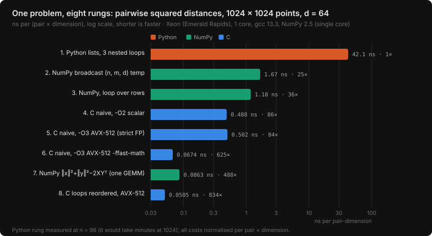

[← Back to Table of Contents](./README.md)

# Chapter 20 — Hands-On: One Kernel, Eight Rungs

> *"Every rung of the ladder is a different chapter of this book. The surprise is which rungs go down."*

## Overview

This chapter climbs one problem from pure Python to hand-ordered AVX-512 C, measuring every step on the
same machine (one pinned core of a Xeon, Emerald Rapids; gcc 13.3; NumPy 2.5). The problem is
**pairwise squared Euclidean distances** between two sets of 1024 points in 64 dimensions, the inner
loop of k-nearest-neighbours, k-means, RBF kernels, contrastive losses and embedding retrieval. Two rungs
go *down*, and the best result comes from changing the loop order, not from a flag. Everything here is
reproducible with three commands.

<div class="fig"></div>

```bash
python tools/measurements/run_bench.py      # C rungs (and every other C measurement), ~2 minutes
python tools/measurements/python_bench.py   # Python and NumPy rungs
python tools/make_figures.py                # regenerates the chart above from results.json
```

$$D_{ij} = \sum_{k=1}^{d} (X_{ik} - Y_{jk})^2, \qquad X \in \mathbb{R}^{n \times d},\; Y \in \mathbb{R}^{m \times d},\; n = m = 1024,\; d = 64$$

That is $n \cdot m \cdot d = 67$ million (pair, dimension) terms, about 200 million floating-point
operations. All costs below are normalised to **ns per (pair × dimension)** so that the pure-Python rung,
which had to be measured at $n = 96$, compares fairly.

---

## The rungs

| Rung | Implementation | ns / (pair·dim) | vs rung 1 | vs previous best | What changed | Chapter |
|:---:|---|:---:|:---:|:---:|---|:---:|
| **1** | Python lists, three nested loops | 42.1 | 1× | — | baseline | [0](./00_why_vectorization.md) |
| **2** | NumPy, broadcast `(n,1,d) − (1,m,d)` | 1.67 | 25× | 25× | left the interpreter | [11](./11_array_programming.md) |
| **3** | NumPy, Python loop over rows | 1.18 | 36× | 1.4× | *smaller* temporaries beat full broadcasting | [11](./11_array_programming.md) |
| **4** | C, naive triple loop, `-O2` scalar | 0.488 | 86× | 2.4× | no temporaries at all; one pass | [7](./07_memory_layout.md) |
| **5** | C, naive, `-O3 -march=x86-64-v4` | 0.502 | 84× | 0.97× ↓ | the vectorizer refused: inner loop is a float reduction | [6](./06_dependences.md), [13](./13_auto_vectorization.md) |
| **6** | C, naive, `-O3 … -ffast-math` | 0.0674 | 625× | 7.2× | permission to reassociate | [6](./06_dependences.md) |
| **7** | NumPy, $\lVert x\rVert^2 + \lVert y\rVert^2 - 2XY^\top$ | 0.0863 | 488× | — | algorithm → one GEMM (BLAS) | [10](./10_technique_catalogue.md) |
| **8** | C, loops reordered (vectorize over $j$), `-O3 -march=x86-64-v4`, no fast-math | **0.0505** | **834×** | 1.33× | outer-loop vectorization: no reassociation needed | [10](./10_technique_catalogue.md) |

Rungs 2 and 5 are the instructive failures. Rung 2 is "fully vectorized" NumPy and is slower than
rung 3's half-vectorized loop, because it writes and reads a 256 MB temporary. Rung 5 adds AVX-512 to
the compile line and gets nothing, because the compiler may not reorder the float sum. Neither problem
is about lanes.

---

## Rung 1 → 2: leave the interpreter (25×)

```python
def pdist_loop(X, Y):                           # rung 1: 42.1 ns per pair·dim
    D = [[0.0] * len(Y) for _ in X]
    for i in range(len(X)):
        for j in range(len(Y)):
            acc = 0.0
            for k in range(len(X[0])):
                t = X[i][k] - Y[j][k]
                acc += t * t
            D[i][j] = acc
    return D

def pdist_broadcast(X, Y):                      # rung 2: 1.67 ns
    diff = X[:, None, :] - Y[None, :, :]        # (1024, 1024, 64) float32 = 256 MB
    return np.einsum("ijk,ijk->ij", diff, diff)
```

Each Python-level `t = a - b` is a dynamic dispatch and an object allocation, about 40 ns of overhead
for a few nanoseconds of arithmetic. NumPy removes that, but the shape strip of the broadcast
says $n \cdot m \cdot d = 67$ M floats: 256 MB written by the subtraction and read back by `einsum`. The
memory strip and the roofline (Chapters 4 and 9) predict a DRAM-bound kernel, and it is one.

## Rung 2 → 3: smaller temporaries (1.4×)

```python
def pdist_rowloop(X, Y):                        # rung 3: 1.18 ns
    return np.stack([((x[None, :] - Y) ** 2).sum(axis=1) for x in X])
```

Each iteration's temporaries are (1024, 64) floats, 256 KB, which fit in L2. The Python loop costs
1024 calls × a few µs, which is small against the arithmetic. This is the Chapter 11 lesson in one line:
a partly vectorized loop with cache-sized temporaries can beat a fully vectorized expression with a
DRAM-sized one.

## Rung 3 → 4 → 5: compiled, and then not vectorized

```c
void pdist_naive(long n, long m, long d, const float *restrict X,
                 const float *restrict Y, float *restrict D) {
  for (long i = 0; i < n; i++)
    for (long j = 0; j < m; j++) {
      float acc = 0.0f;
      for (long k = 0; k < d; k++) { float t = X[i*d + k] - Y[j*d + k]; acc += t * t; }
      D[i*m + j] = acc;
    }
}
```

Rung 4, scalar C, is 2.4× faster than rung 3 just by avoiding temporaries. Rung 5 then asks for AVX-512 and
gets 0.502 ns, no better. The compiler explains (clang 18, `remarks.txt`):

<div class="crt">
<div class="crt-bar">tty7 — clang -O3 -march=x86-64-v4 -Rpass-analysis=loop-vectorize bench.c</div>
<div class="crt-screen"><pre>
bench.c:123:7:  <span class="bad">remark: loop not vectorized</span>
bench.c:125:13: <span class="bad">remark: loop not vectorized: cannot prove it is safe to reorder
                floating-point operations; allow reordering by specifying
                '#pragma clang loop vectorize(enable)' before the loop or by
                providing the compiler option '-ffast-math'.</span>
bench.c:141:7:  remark: vectorized loop (vectorization width: 8, interleaved count: 4)  <span class="dim">&lt;- rung 8</span>
</pre></div>
</div>

The innermost loop is a reduction over $k$ (Chapter 6). Vectorizing it means splitting `acc` into
partial sums, which changes the rounding, so the compiler needs permission.

## Rung 5 → 6: grant permission (7.2×)

Compiling the identical source with `-ffast-math` gives 0.0674 ns, a 7.2× jump from a flag. It works,
and it brings `-ffast-math`'s other assumptions (no NaN or Inf, reciprocal approximations, flushed
denormals) into the whole file. `#pragma omp simd reduction(+:acc)` on the $k$ loop grants the same
permission to that loop alone (Chapter 13).

## Rung 7: change the algorithm (488× over rung 1)

```python
def pdist_gemm(X, Y):                            # rung 7: 0.0863 ns
    xx = np.einsum("ij,ij->i", X, X)[:, None]
    yy = np.einsum("ij,ij->i", Y, Y)[None, :]
    return np.maximum(xx + yy - 2.0 * (X @ Y.T), 0.0)
```

Expanding $\lVert x - y\rVert^2 = \lVert x\rVert^2 + \lVert y\rVert^2 - 2\,x \cdot y$ turns 67 M
subtract-square-adds into one 1024 × 64 × 1024 GEMM plus two cheap vectors. The GEMM runs in BLAS,
already blocked and vectorized. This is the trick used by FAISS, `sklearn.metrics.pairwise_distances`,
and `torch.cdist`'s matmul path. It has a numerical cost: subtracting large nearly equal numbers
cancels. `test_pdist_gemm_cancellation_needs_clamp` builds points near 1000 with spread $10^{-3}$, where
the float32 GEMM form is off by more than $10^{-3}$ and can go negative without the clamp.

<div class="callout warn"><span class="callout-title">Trap</span>
<p>The GEMM reformulation is a different floating-point algorithm. For points far from the origin and close
to each other (e.g. un-centred embeddings), compute in float64, centre the data first, or fall back to the
direct form for small distances. <code>torch.cdist</code> exposes exactly this choice as
<code>compute_mode</code>.</p>
</div>

## Rung 8: choose a better vector axis (834×)

```c
void pdist_outer(long n, long m, long d, const float *restrict X,
                 const float *restrict YT, float *restrict D) {   // YT is Y transposed: d x m
  for (long i = 0; i < n; i++) {
    float *row = D + i*m;
    for (long j = 0; j < m; j++) row[j] = 0.0f;
    for (long k = 0; k < d; k++) {
      float xv = X[i*d + k];                    // broadcast
      const float *yk = YT + k*m;               // contiguous along j
      for (long j = 0; j < m; j++) { float t = xv - yk[j]; row[j] += t * t; }   // a map over j
    }
  }
}
```

The innermost loop now runs over $j$, the other point, not over $k$. Each `row[j]` is its own
accumulator, so there is no cross-lane reduction, no reordering of any float sum, and no
`-ffast-math`. Storing $Y$ transposed makes the $j$ axis contiguous (Chapter 7). clang reports
`vectorization width: 8, interleaved count: 4`, and the kernel runs at 0.0505 ns: 9.7× faster than scalar
C, faster than the fast-math version, and *bit-identical* to the scalar version of the same loop order.
This is **outer-loop vectorization**, and **layout change** made it cheap (Chapter 10, Ov and Sa).

---

## What the ladder teaches

<div class="corkboard">
<div class="sticky">Leaving Python was worth 25–86×.<small>Interpreter overhead per element dwarfs arithmetic (rungs 1→2→4).</small></div>
<div class="sticky p">"Fully vectorized" lost to a loop.<small>A 256 MB temporary made NumPy DRAM-bound (rung 2 vs 3).</small></div>
<div class="sticky b">Wider registers did nothing<small>until legality was settled (rung 5).</small></div>
<div class="sticky g">The best fix needed no flag.<small>Reordering loops removed the reduction instead of permitting it (rung 8).</small></div>
<div class="sticky o">Algorithms beat instructions.<small>The GEMM form is 488× over Python in three lines, with a numerical caveat (rung 7).</small></div>
</div>

### Rungs not taken

| Next rung | Expected effect | Why | Chapter |
|---|---|---|:---:|
| **Block for L1/L2** (tile $i$ and $j$) | the 1024 × 64 panel of $Y^\top$ (256 KB) already fits L2; gains mostly for larger $m$ | reuse $Y$ tiles across many $i$ | [18](./18_ml_kernels.md) |
| **Use all 4 cores** | ~4× on rows of $D$ | independent across $i$ | — |
| **AMX bf16 GEMM form** | up to 13× more compute ceiling on this core | rung 7's GEMM on tile engines, with bf16 cancellation worse than fp32 | [16](./16_matrix_engines.md) |
| **GPU** (`torch.cdist` or a Triton kernel) | orders of magnitude more throughput for large $n$ | same GEMM form on tensor cores | [15](./15_gpus_simt.md) |

<div class="callout ponder"><span class="callout-title">Ponder</span>
<p>Rung 8's loop order made the "point" axis the vector and turned a reduction into a map. In your own hot
loop, which axis is currently the vector, and is it the reduction axis? If so, is there another independent
axis you could put on the lanes instead?</p>
</div>

---

## Do it yourself

1. Pick a function in your code that is a Python loop over examples, rows or pairs.
2. Write the scalar reference first and keep it; add a differential test over random sizes, including
   sizes below and around the lane count (Chapter 6).
3. Climb: NumPy whole-array → check temporaries against the cache sizes → `einsum` / matmul
   reformulation → compiled loop (`numba`, C, `torch.compile`) → read the vectorization remarks → reorder
   loops or layouts before reaching for flags or intrinsics.
4. At every rung record the time, the size, the machine, and which roof you are under (Chapter 9).

---

## Key Takeaways

- On one core the same computation spanned 834× from pure Python to reordered AVX-512 C.
- Two "upgrades" were not: full broadcasting lost to a row loop (memory), and AVX-512 flags did nothing until floating-point legality was addressed.
- `-ffast-math` bought 7.2×, but reordering loops to vectorize over an independent axis bought more with no change in semantics.
- Algorithmic reformulation into a GEMM is the most effective NumPy-level rung and carries a cancellation risk that needs a clamp or higher precision.
- Each rung maps to one chapter; the ladder is a checklist for your own kernels.

## Check Yourself

<details class="check"><summary>Why is rung 8 bit-identical to the scalar version of the same loop order, but rung 6 is not bit-identical to rung 4?</summary>
In rung 8 every output D[i][j] is still accumulated in the same k order by its own lane; vectorization runs different j in parallel without reordering any sum. Rung 6 splits each k-sum into partial sums across lanes, changing the order of additions.
</details>

<details class="check"><summary>Rung 2 materialises an (n, m, d) temporary. At what n = m (d = 64, float32) does it exceed a 2 MB L2 cache?</summary>
n² · 64 · 4 B > 2 MB → n² > 8192 → n > ~90. At n = 1024 it is 256 MB, well beyond L3 on most machines.
</details>

<details class="check"><summary>What would you expect from compiling rung 8 with <code>-march=x86-64</code> (SSE2) instead?</summary>
It still vectorizes (no legality issue), but with 4 lanes instead of 8 or 16: in-cache work would be roughly 2× slower than AVX2-width code, consistent with the saxpy and SoA rows in Chapter 7.
</details>

## References

| Source | Authors / Org, Year | Link | What this chapter takes from it |
|--------|--------------------|------|--------------------------------|
| Billion-scale similarity search with GPUs (FAISS) | Johnson, Douze & Jégou, IEEE TBD 2019 | arXiv:1702.08734 | Distance computation as GEMM |
| scikit-learn `pairwise_distances` / `euclidean_distances` documentation | scikit-learn | scikit-learn.org | The dot-product trick and its precision caveat |
| PyTorch `torch.cdist` documentation (`compute_mode`) | PyTorch | pytorch.org/docs | Matmul vs direct computation |
| There's plenty of room at the Top | Leiserson et al., Science 2020 | doi:10.1126/science.aam9744 | The original "ladder" methodology for matmul |
| This book's code and measurements | `code/vzlab/patterns.py`, `code/bench/bench.c`, `results.json`, `remarks.txt` | [repo](https://github.com/karam-nus/vectorization) | Every rung; correctness tests |

---

**Next:** [Chapter 21 — The Debugging & Profiling Playbook](./21_debugging_playbook.md) — when the kernel is slow, wrong, or slow only sometimes.
